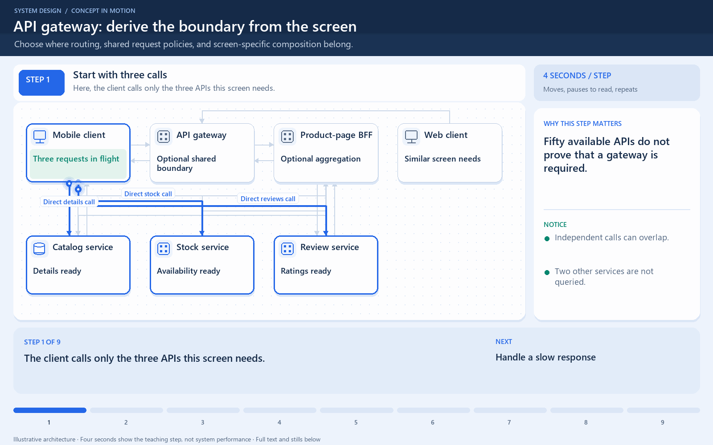

# API gateway: derive the boundary from the screen

[← Animation index](README.md)

**Problem:** Choose where routing, shared request policies, and screen-specific composition belong.

**Scenario:** Five services expose fifty APIs; this screen needs three results from different services.

The full system map stays visible as the highlighted path and component states change. Every stage lasts four seconds: the path moves, then the completed state pauses so you can read it. The sequence repeats automatically. Values are illustrative; playback speed is not system timing.

## Read the same sequence without motion

1. **Start with three calls.** The client calls only the three APIs this screen needs.
   - **Why it matters:** Fifty available APIs do not prove that a gateway is required.
   - **Notice:** Independent calls can overlap; Two other services are not queried.
2. **Handle a slow response.** Details and stock arrive, but reviews exceed the screen deadline.
   - **Why it matters:** Someone must own partial results even when the network calls are simple.
   - **Notice:** Which results are required; Where is the screen deadline.
3. **Notice repeated work.** Mobile and web clients both need routing, credentials, and failure policies.
   - **Why it matters:** Choose a boundary because a responsibility is repeated or fragile.
   - **Notice:** Do not add components by API count; A small client can keep direct calls.
4. **Introduce an entry point.** A gateway routes a stable public request after shared policy checks.
   - **Why it matters:** Gateway routing and response composition are separate responsibilities.
   - **Notice:** Services still check resource access; Routing alone does not merge results.
5. **Compose only if useful.** A screen-specific aggregator requests the three independent results concurrently.
   - **Why it matters:** One client request can contain several downstream calls and their failure risks.
   - **Notice:** BFF is optional screen-specific logic; Extra hops still add overhead.
6. **Apply a response deadline.** The aggregator receives required facts while reviews remain unavailable.
   - **Why it matters:** A partial-result policy makes the failure visible instead of inventing data.
   - **Notice:** Reviews may be optional on this screen; Never invent unavailable stock.
7. **Return an honest screen.** The client receives details, stock, and an explicit unavailable-review status.
   - **Why it matters:** The screen contract determines whether partial success is useful.
   - **Notice:** Preserve status for missing sections; Buying needs authoritative stock rules.
8. **Account for the new risk.** If the entry path fails, all requests using that path are affected.
   - **Why it matters:** Redundancy and recovery must match the dependency the design introduced.
   - **Notice:** Use redundant entry points if required; Measure added and downstream latency.
9. **Defend your choice.** Keep the simplest arrangement that satisfies the actual screen and service requirements.
   - **Why it matters:** Revisit your first sketch: what became simpler, and what new failure did you accept?
   - **Notice:** Direct calls can remain reasonable; Gateway plus BFF is not mandatory.

**Design tradeoff:** An entry point simplifies client routing; optional aggregation adds coordination, latency, and a failure dependency.

[View all states as still images](../assets/animations/api-gateway-steps.png)

## Related lessons

- [API Gateway](../curriculum/06-api-fundamentals/03-api-gateway.md)
