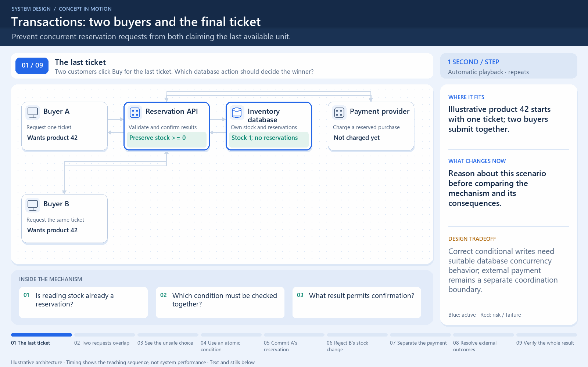

# Transactions: two buyers and the final ticket

[← Animation index](README.md)

**Problem:** Prevent concurrent reservation requests from both claiming the last available unit.

**Scenario:** Illustrative product 42 starts with one ticket; two buyers submit together.

The full system map stays visible as the highlighted path and component states change. Every stage lasts one second and the sequence repeats automatically. Values are illustrative; playback speed is not system timing.

## Read the same sequence without motion

1. **The last ticket.** Two customers click Buy for the last ticket. Which database action should decide the winner? Reason about this scenario before comparing the mechanism and its consequences.
   Is reading stock already a reservation?; Which condition must be checked together?; What result permits confirmation?.
2. **Two requests overlap.** A and B reach the reservation service before either has a confirmed result. Concurrency is about overlapping work, even with one visible service endpoint.
   One API can handle concurrent calls.; A read is not yet a reservation..
3. **See the unsafe choice.** Separate read-then-write checks can let both callers observe stock 1. A transaction wrapper alone does not settle the isolation behavior.
   This is the unsafe alternative.; Do not confirm from a stale read..
4. **Use an atomic condition.** Instead, update this product only while quantity is positive. Scope the update to the product and check the actual write result.
   WHERE product_id = 42; AND quantity > 0; Decrement and check happen together..
5. **Commit A's reservation.** The database changes one row and commits stock plus its related reservation consistently. Only the successful committed result may justify A's confirmation.
   Illustrative outcome: A wins.; Reverse arrival can let B win.; Keep related changes in one transaction..
6. **Reject B's stock change.** B's condition now finds no positive quantity, so it changes zero rows. The loser must not receive a success response for a reservation it did not obtain.
   Database conflicts may require retries.; Choose suitable isolation or locking..
7. **Separate the payment.** A's payment call crosses another service boundary; a local transaction cannot atomically cover it. Do not hold a local row lock while assuming an external charge shares the same commit.
   Use safe retry identifiers.; Record recoverable purchase state..
8. **Resolve external outcomes.** A payment failure or unknown result needs a defined recovery or reservation-expiry policy. Correct stock allocation and correct charging are related but distinct invariants.
   A timeout does not prove no charge.; Compensation needs its own rules..
9. **Verify the whole result.** Test simultaneous requests and interruptions; confirm no extra ticket or duplicate side effect appears. Measure correctness under races, not only successful sequential requests.
   Keep database transactions short.; Confirm only documented outcomes..

**Design tradeoff:** Correct conditional writes need suitable database concurrency behavior; external payment remains a separate coordination boundary.

[View all states as still images](../assets/animations/atomic-stock-steps.png)

## Related lessons

- [Transactions](../curriculum/03-databases/08-transactions.md)
- [ACID and BASE consistency models](../curriculum/03-databases/09-acid-and-base-consistency-models.md)
