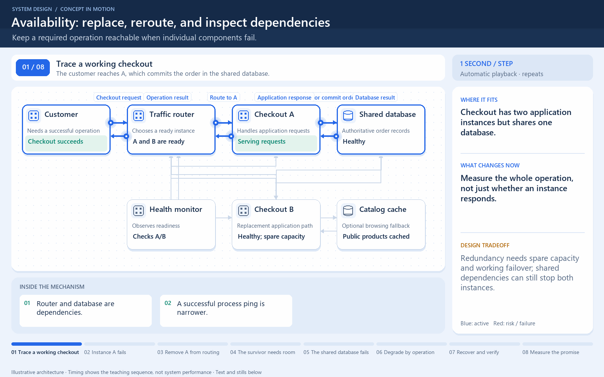

# A replacement helps only if traffic reaches it

[← Animation index](README.md)

This is one illustrative scenario, not a complete implementation or a simulation of all failure modes. The related lesson explains assumptions and tradeoffs.

Open the looping animation

## Read the same sequence without motion

1. Two app instances can handle the same request contract.
2. The router initially selects A.
3. A stops responding. A second box alone does not redirect traffic.
4. A configured health and routing policy switches suitable traffic to B.
5. Test shared dependencies too. Both apps can fail if their common database fails.

[View all states as still images](../assets/animations/availability-failover-steps.png)

## Related lessons

- [Availability](../curriculum/01-core-concepts/03-availability.md)
