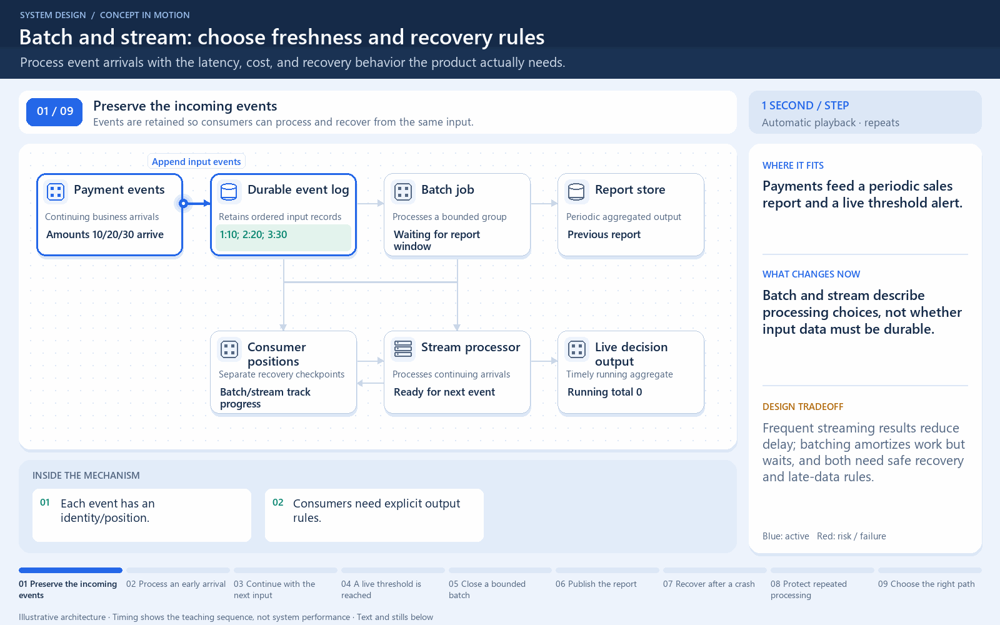

# Batch and streaming organize the same arrivals differently

[← Animation index](README.md)

This is one illustrative scenario, not a complete implementation or a simulation of all failure modes. The related lesson explains assumptions and tradeoffs.

Open the looping animation

## Read the same sequence without motion

1. Compare two alternatives for the same arriving records.
2. E1 waits for a batch boundary; a streaming path can begin E1 now.
3. E2 joins the buffer; the streaming path can handle it as it arrives.
4. At its boundary, the batch processor receives the accumulated group.
5. Batching amortizes overhead but adds waiting. Streaming still has processing delay.

[View all states as still images](../assets/animations/batch-stream-steps.png)

## Related lessons

- [Batch vs stream processing](../practice/TRADEOFFS.md)
