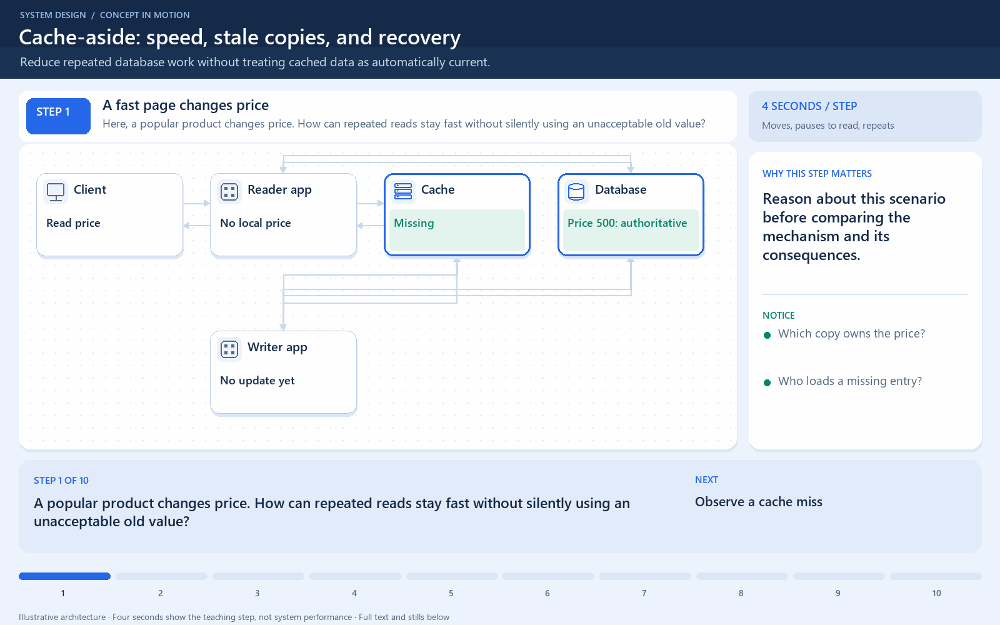

# Cache-aside: speed, stale copies, and recovery

[← Animation index](README.md)

**Problem:** Reduce repeated database work without treating cached data as automatically current.

**Scenario:** Illustrative product 42 changes from price 500 to 550 while invalidation fails.

The full system map stays visible as the highlighted path and component states change. Every stage lasts one second and the sequence repeats automatically. Values are illustrative; playback speed is not system timing.

## Read the same sequence without motion

1. **A fast page changes price.** A popular product changes price. How can repeated reads stay fast without silently using an unacceptable old value? Reason about this scenario before comparing the mechanism and its consequences.
   Which copy owns the price?; Who loads a missing entry?; What if invalidation fails?.
2. **Observe a cache miss.** The reader asks the cache and learns that no value is available. A miss is normal behavior, not automatically a service failure.
   Do not confuse miss with cache outage.; A miss still needs database work..
3. **Read the authoritative value.** The application reads price 500 from the database, rather than asking the cache to load it. Cache-aside places the loading decision in application code.
   Read-through uses a different boundary.; The database is still the authority..
4. **Fill and return.** The application caches the value and returns price 500 to the client. The cache now helps later requests reuse work.
   Choose an appropriate key and TTL.; Include inputs that change the result..
5. **Serve a later hit.** Another read uses the cached 500 without repeating the database query. Measure avoided origin work and latency, not hit rate alone.
   A hit does not prove freshness.; Private values need isolated keys..
6. **Commit a new price.** The writer commits 550; until invalidation succeeds, the cached 500 is old. A database commit and cache invalidation are separate failure boundaries.
   Do not claim cross-store atomicity.; Old entries can outlive a write..
7. **Invalidation fails.** The writer cannot remove the old entry, although the database update already succeeded. An invalidation recipe needs recovery behavior as well as a happy path.
   Monitor failed invalidations.; Use bounded, safe retries..
8. **A hit can now be wrong.** The next product-page read returns cached 500 unless its freshness policy prevents it. A checkout must enforce its actual payable price through an authoritative rule.
   TTL does not imply immediate freshness.; Some displays may permit staleness..
9. **Repair the copy.** A successful purge lets the next miss reload 550 and replace the old cached value. Recovery must eventually make stale copies converge under the chosen policy.
   Concurrent stale fills still need rules.; Version checks can support stronger rules..
10. **Protect the miss path.** If many callers miss together, bound reload work and protect database capacity. A cache adds capacity only when failure and miss behavior remain controlled.
   Coalescing scope must span participants.; Test total cache loss and hot keys..

**Design tradeoff:** Cache hits reduce repeated work, but failures and races require freshness rules, memory, and additional coordination.

[View all states as still images](../assets/animations/cache-aside-steps.png)

## Related lessons

- [Caching](../curriculum/05-caching/01-caching.md)
- [Caching Strategies](../curriculum/05-caching/02-caching-strategies.md)
- [Distributed Caching](../curriculum/05-caching/04-distributed-caching.md)
