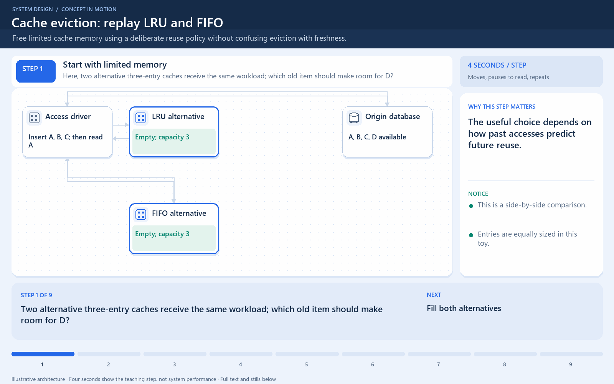

# LRU and FIFO make different choices

[← Animation index](README.md)

This is one illustrative scenario, not a complete implementation or a simulation of all failure modes. The related lesson explains assumptions and tradeoffs.

Open the looping animation

## Read the same sequence without motion

1. Insert A, B, and C into caches with room for three equal-size entries.
2. Read A. LRU updates recency; FIFO keeps insertion order.
3. Insert D. LRU evicts B, the least recently used entry.
4. FIFO evicts A, the earliest inserted entry.
5. Eviction frees memory. It does not establish that a cached price is current.

[View all states as still images](../assets/animations/cache-eviction-steps.png)

## Related lessons

- [Cache Eviction Policies](../curriculum/05-caching/03-cache-eviction-policies.md)
