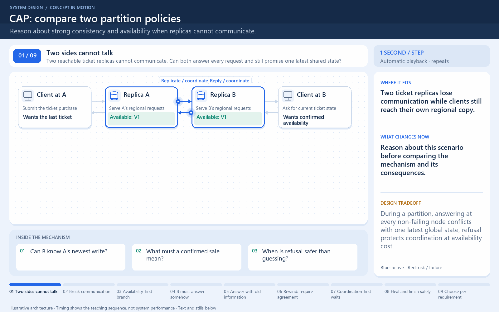

# CAP: a choice during a partition

[← Animation index](README.md)

This is one illustrative scenario, not a complete implementation or a simulation of all failure modes. The related lesson explains assumptions and tradeoffs.

Open the looping animation

## Read the same sequence without motion

1. Both replicas initially know that a ticket is available.
2. A records sold, then communication to B is unavailable.
3. A request reaches non-failing B, which cannot confirm the current state at A.
4. Choice 1: answer without the latest write; consistency may be sacrificed.
5. Choice 2: refuse or wait; CAP availability is sacrificed for this request.

[View all states as still images](../assets/animations/cap-partition-steps.png)

## Related lessons

- [CAP Theorem](../curriculum/04-distributed-data/01-cap-theorem.md)
- [Strong vs eventual consistency](../practice/TRADEOFFS.md)
