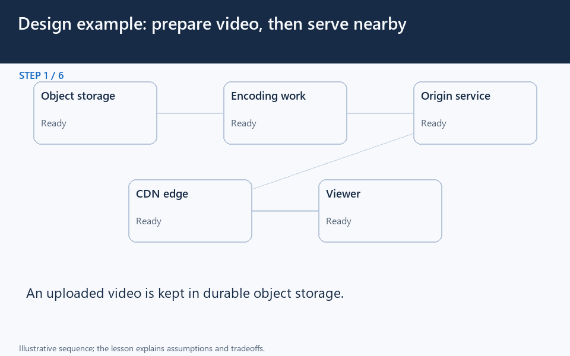

# Design example: prepare video, then serve nearby

[← Animation index](README.md)

This is one illustrative scenario, not a complete implementation or a simulation of all failure modes. The related lesson explains assumptions and tradeoffs.

Open the looping animation

## Read the same sequence without motion

1. An uploaded video is kept in durable object storage.
2. Encoding work creates suitable versions and segments; retries must be safe.
3. Prepared segments become available to the origin delivery path.
4. A viewer requests a segment from the CDN edge.
5. On a miss, the edge fetches allowed content from the origin.
6. Nearby reuse reduces origin delivery load; cold caches and access control still matter.

[View all states as still images](../assets/animations/case-netflix-steps.png)

## Related lessons

- [Netflix](../practice/netflix.md)
