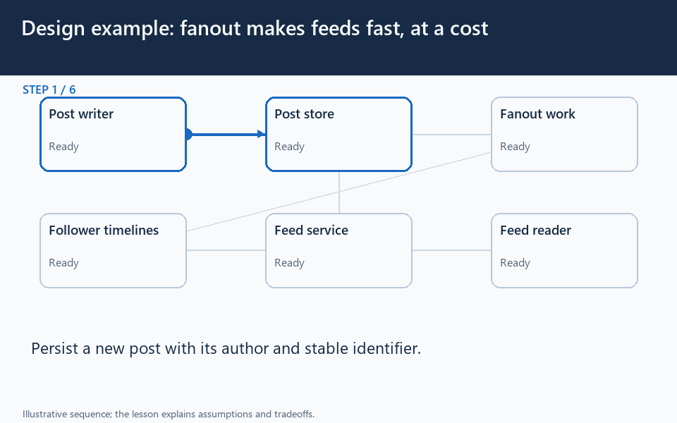

# Feeds: publish, fan out, read, and enforce visibility

[← Animation index](README.md)

**Problem:** Serve follower feeds while balancing publication fanout, reading work, freshness, and visibility.

**Scenario:** Ordinary posts and a celebrity post compete with delayed timeline workers.

The full system map stays visible as the highlighted path and component states change. Every stage lasts one second and the sequence repeats automatically. Values are illustrative; playback speed is not system timing.

## Read the same sequence without motion

1. **Store the original post.** The post API records authoritative content, access rules, and recoverable fanout intent. Publication acceptance does not prove every follower timeline is updated.
   Keep a durable source of content.; Define the required freshness.; Persist intent with the post commit..
2. **Distribute references later.** A queue decouples publication from follower timeline work. Asynchronous precomputation adds a measurable post-to-feed delay.
   Backlog age measures waiting.; Retries need safe reference insertion.; Retry publication from durable intent..
3. **Precompute ordinary feeds.** The worker adds P references to the followers' timelines. References avoid copying full post content into every timeline.
   Content lookup still costs work.; Visibility must still be enforced..
4. **Read a bounded page.** A follower asks the feed API for a page of timeline references. Pagination bounds work instead of fetching an entire lifetime feed.
   A reference is not the content.; Feed ordering is an explicit choice..
5. **Fetch currently allowed posts.** The API resolves content and current access before returning the page. An old timeline reference must not bypass current deletion or privacy rules.
   Cache with the right user context.; Check access at the content boundary..
6. **A celebrity changes the cost.** A huge follower count turns one publication into a large distribution burst. Average followers per post can hide the worst write bursts.
   1k posts/s x 300 followers: 300k writes.; A celebrity workload is different..
7. **Choose a mixed strategy.** Ordinary authors remain precomputed; large-author content is merged during reads. A mixed design reduces massive write bursts while increasing read-path work.
   Use measured fanout and read frequency.; Do not copy an arbitrary threshold..
8. **A deleted post lingers.** The author disables P while a timeline reference still exists. Reference cleanup and access enforcement are different tasks.
   Synchronous global cleanup is costly.; Never expose a forbidden cached copy..
9. **Return and measure the choice.** The feed excludes forbidden content and measures read latency and publication lag. Assess feed-read latency, timeline writes, and post-to-feed delay together.
   Cheaper reads can mean more writes.; Fresher feeds may need extra work..

**Design tradeoff:** Precomputing feeds reduces read work but amplifies writes; merging large authors at read time shifts cost back to reads.

[View all states as still images](../assets/animations/case-twitter-steps.png)

## Related lessons

- [Twitter](../practice/twitter.md)
