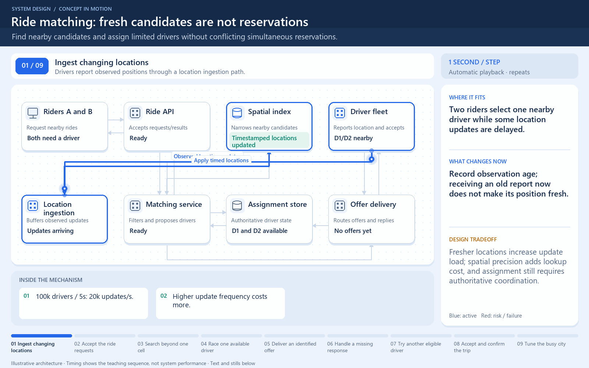

# Ride matching: fresh candidates are not reservations

[← Animation index](README.md)

**Problem:** Find nearby candidates and assign limited drivers without conflicting simultaneous reservations.

**Scenario:** Two riders select one nearby driver while some location updates are delayed.

The full system map stays visible as the highlighted path and component states change. Every stage lasts four seconds: the path moves, then the completed state pauses so you can read it. The sequence repeats automatically. Values are illustrative; playback speed is not system timing.

## Read the same sequence without motion

1. **Ingest changing locations.** Drivers report observed positions through a location ingestion path.
   - **Why it matters:** Record observation age; receiving an old report now does not make its position fresh.
   - **Notice:** 100k drivers / 5s: 20k updates/s; Higher update frequency costs more.
2. **Accept the ride requests.** Two riders request matches through the ride API.
   - **Why it matters:** A matching result requires more than a nearby-driver lookup.
   - **Notice:** Separate discovery from assignment; State the allowed location staleness.
3. **Search beyond one cell.** The matcher considers neighboring spatial regions and filters stale candidates.
   - **Why it matters:** A closer driver can lie across a cell boundary rather than inside the rider's cell.
   - **Notice:** Compute actual candidate distances; A fast stale answer can be wrong.
4. **Race one available driver.** A and B both propose D1, but only one conditional claim can win.
   - **Why it matters:** The authoritative state transition prevents a shared candidate from becoming two assignments.
   - **Notice:** Cached availability is not authority; Failed claims must be retried safely.
5. **Deliver an identified offer.** The winning assignment creates an offer addressed to the driver.
   - **Why it matters:** Offer delivery and reservation state need explicit identifiers and timeout behavior.
   - **Notice:** A reserved driver is not yet accepted; Repeated delivery may occur.
6. **Handle a missing response.** D1 becomes unreachable and the offer reaches its timeout policy.
   - **Why it matters:** Do not release or reuse state blindly if an acceptance can race the timeout.
   - **Notice:** Use conditional state transitions; Check current assignment/version.
7. **Try another eligible driver.** After the allowed transition, the matcher conditionally claims D2 and sends a new offer.
   - **Why it matters:** A fallback candidate still needs a new authoritative claim.
   - **Notice:** Recheck eligibility and freshness; Do not reuse expired ownership blindly.
8. **Accept and confirm the trip.** D2 accepts and the assignment store records the valid transition.
   - **Why it matters:** Only the current accepted assignment should produce a confirmed rider result.
   - **Notice:** Old offer replies must be rejected; Receipt and state change can race.
9. **Tune the busy city.** Measure matching latency, location age, and hot-region load together.
   - **Why it matters:** Adaptive updates and partitions trade freshness, maintenance work, and boundary coordination.
   - **Notice:** Equal areas can have unequal traffic; More partitions are not a universal fix.

**Design tradeoff:** Fresher locations increase update load; spatial precision adds lookup cost, and assignment still requires authoritative coordination.

[View all states as still images](../assets/animations/case-uber-steps.png)

## Related lessons

- [Uber](../practice/uber.md)
