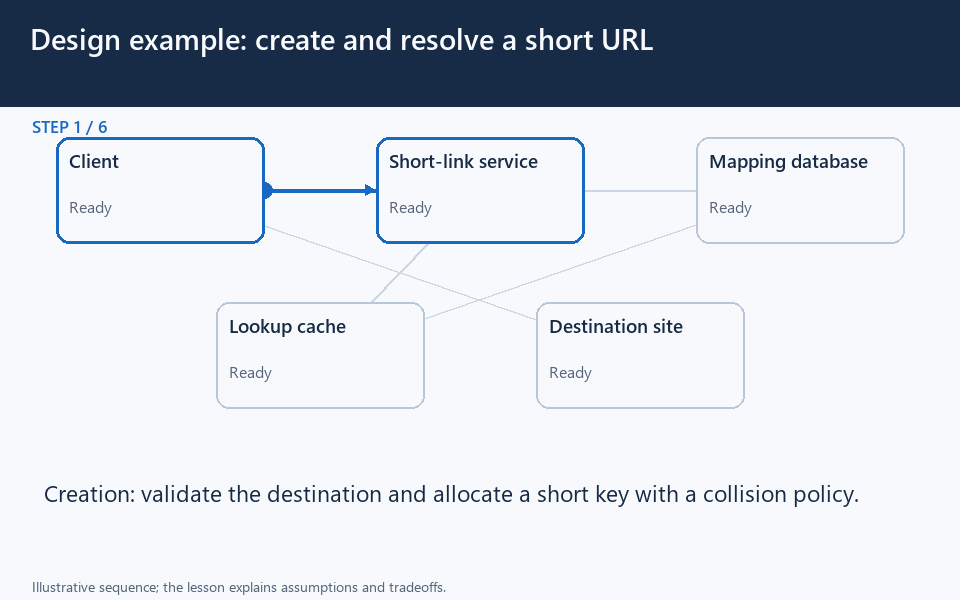

# URL shortener: create, resolve, cache, and disable

[← Animation index](README.md)

**Problem:** Create unique aliases and serve redirect-heavy traffic with explicit freshness and abuse rules.

**Scenario:** A campaign link becomes viral, then its owner disables it.

The full system map stays visible as the highlighted path and component states change. Every stage lasts four seconds: the path moves, then the completed state pauses so you can read it. The sequence repeats automatically. Values are illustrative; playback speed is not system timing.

## Read the same sequence without motion

1. **Define the write first.** The owner submits a destination to the creation API for validation.
   - **Why it matters:** A short-link system needs a write contract, not only a fast redirect path.
   - **Notice:** Check ownership and input policy; A short code is not authorization.
2. **Propose and reserve a code.** The API gets a candidate and attempts a unique database insertion.
   - **Why it matters:** The authoritative store must prevent two links from sharing one code.
   - **Notice:** Random generation can collide; Do not overwrite an existing mapping.
3. **Recover a collision.** A collision causes a new candidate attempt rather than corruption.
   - **Why it matters:** Collision handling belongs on the creation path before a link is published.
   - **Notice:** Uniqueness is enforced atomically; A check-then-write race is unsafe.
4. **Publish the saved alias.** The successful database write lets the API return the alias to its owner.
   - **Why it matters:** Return creation success only after the required persistence guarantee is satisfied.
   - **Notice:** The database owns the mapping; Creation and redirect loads differ.
5. **First redirect misses.** A visitor reaches the redirect service; the cache miss triggers a database lookup.
   - **Why it matters:** A cache miss still consumes origin capacity and adds read latency.
   - **Notice:** Read mapping status, not URL alone; Unknown codes need a defined response.
6. **Respond without analytics.** The mapping is cached, the visitor is redirected, and analytics work is queued.
   - **Why it matters:** Delayed analytics can stay off the redirect critical path when the product permits it.
   - **Notice:** Redirect does not await reporting; Queue durability follows its contract.
7. **Viral traffic reuses data.** Repeated visitors use the cached mapping instead of repeating every database read.
   - **Why it matters:** At 20k requests/s and 95% hits, simplified database read load is 1k/s.
   - **Notice:** A hot key can overload a cache node; Measure misses and tail latency.
8. **Disable and invalidate.** The owner disables the link and the API invalidates the known cache entry.
   - **Why it matters:** Server and browser caches need a deliberate policy for disablement freshness.
   - **Notice:** An origin change is not instant purge; Existing client copies may persist.
9. **Resolve against current state.** The next miss reads disabled state and returns an unavailable result.
   - **Why it matters:** Optimize reload bursts without losing the mapping's correctness and abuse rules.
   - **Notice:** Coalesce concurrent popular-key loads; Test updates and cache outage behavior.

**Design tradeoff:** Caches reduce database reads but complicate editing, disabling, miss bursts, and client-side freshness.

[View all states as still images](../assets/animations/case-url-shortener-steps.png)

## Related lessons

- [URL Shortener](../practice/url-shortener.md)
