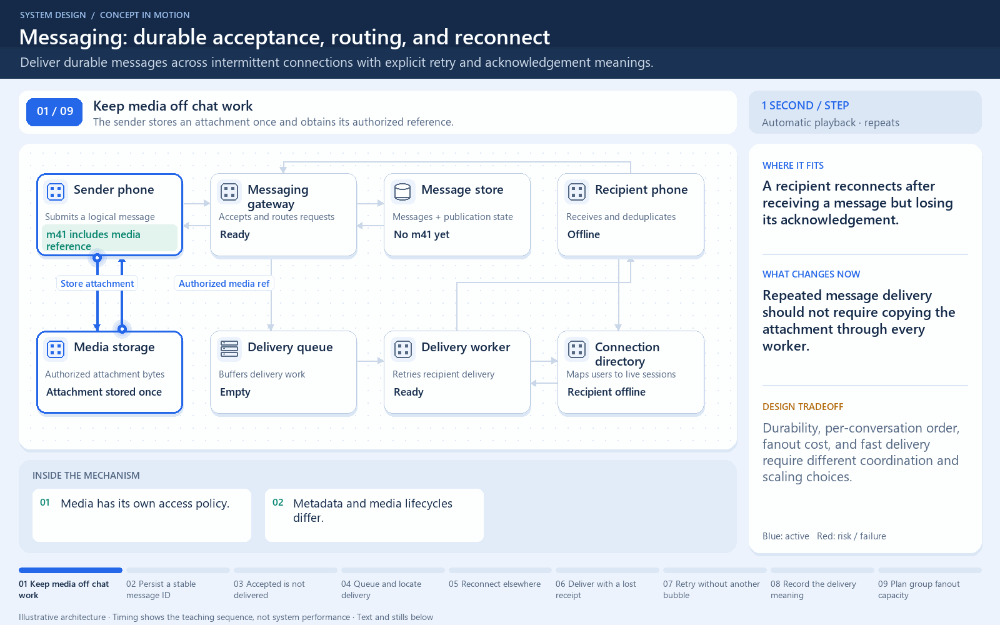

# Messaging: durable acceptance, routing, and reconnect

[← Animation index](README.md)

**Problem:** Deliver durable messages across intermittent connections with explicit retry and acknowledgement meanings.

**Scenario:** A recipient reconnects after receiving a message but losing its acknowledgement.

The full system map stays visible as the highlighted path and component states change. Every stage lasts four seconds: the path moves, then the completed state pauses so you can read it. The sequence repeats automatically. Values are illustrative; playback speed is not system timing.

## Read the same sequence without motion

1. **Keep media off chat work.** The sender stores an attachment once and obtains its authorized reference.
   - **Why it matters:** Repeated message delivery should not require copying the attachment through every worker.
   - **Notice:** Media has its own access policy; Metadata and media lifecycles differ.
2. **Persist a stable message ID.** The gateway records m41 and coordinates its pending delivery event.
   - **Why it matters:** A lost response must not turn a sender retry into another logical message.
   - **Notice:** Enforce deduplication durably; Coordinate persistence and publishing.
3. **Accepted is not delivered.** The store confirms acceptance and the sender receives that precise status.
   - **Why it matters:** A server acceptance guarantee is different from recipient receipt or read status.
   - **Notice:** m41 can survive recipient disconnect; No delivery receipt exists yet.
4. **Queue and locate delivery.** A worker receives pending work and checks the connection directory.
   - **Why it matters:** Offline handling requires durable retrieval or retry, not a permanently open socket.
   - **Notice:** Directory information can be stale; A queue does not add infinite capacity.
5. **Reconnect elsewhere.** The recipient establishes a new session, which becomes discoverable for delivery.
   - **Why it matters:** Connection location and message history have different responsibilities.
   - **Notice:** Resume with conversation sequence data; Do not query every connection server.
6. **Deliver with a lost receipt.** m41 reaches the phone, but its acknowledgement is lost.
   - **Why it matters:** Delivery attempts can repeat even when the first attempt reached the user.
   - **Notice:** The network can lose the response; Timeout does not prove non-delivery.
7. **Retry without another bubble.** The worker sends m41 again and the recipient recognizes its existing identifier.
   - **Why it matters:** Stable identifiers and durable rules prevent retries from becoming duplicate visible messages.
   - **Notice:** Ordering scope is a conversation; Do not infer global chat ordering.
8. **Record the delivery meaning.** A receipt updates status and informs the sender that the recipient received m41.
   - **Why it matters:** Each displayed receipt should correspond to an explicitly defined event.
   - **Notice:** Read status is another event; Reconnect may replay known messages.
9. **Plan group fanout capacity.** A large group multiplies delivery attempts and can grow queue age.
   - **Why it matters:** 100 messages/s to 2,000 recipients imply roughly 200k delivery attempts/s before retries.
   - **Notice:** Isolate hot-group pressure; Parallelize independent conversations.

**Design tradeoff:** Durability, per-conversation order, fanout cost, and fast delivery require different coordination and scaling choices.

[View all states as still images](../assets/animations/case-whatsapp-steps.png)

## Related lessons

- [WhatsApp](../practice/whatsapp.md)
