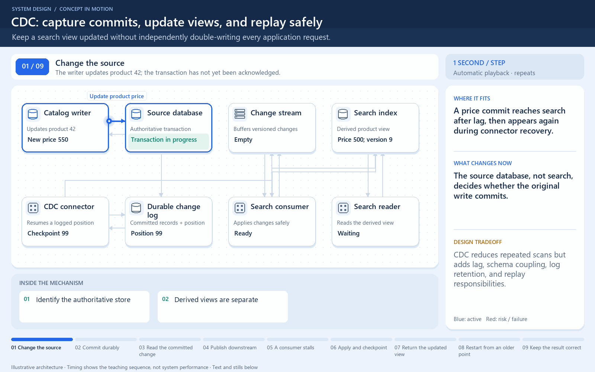

# CDC: a committed change reaches a read view

[← Animation index](README.md)

This is one illustrative scenario, not a complete implementation or a simulation of all failure modes. The related lesson explains assumptions and tradeoffs.

Open the looping animation

## Read the same sequence without motion

1. A database transaction commits a product price change.
2. The connector reads the corresponding durable-log position.
3. A change record reaches the stream; downstream work can lag.
4. The consumer applies the change using an appropriate id/version rule.
5. Recovery may replay records. Consumers must handle duplicates safely.

[View all states as still images](../assets/animations/cdc-steps.png)

## Related lessons

- [Change Data Capture (CDC)](../curriculum/07-asynchronous-communication/04-change-data-capture-cdc.md)
