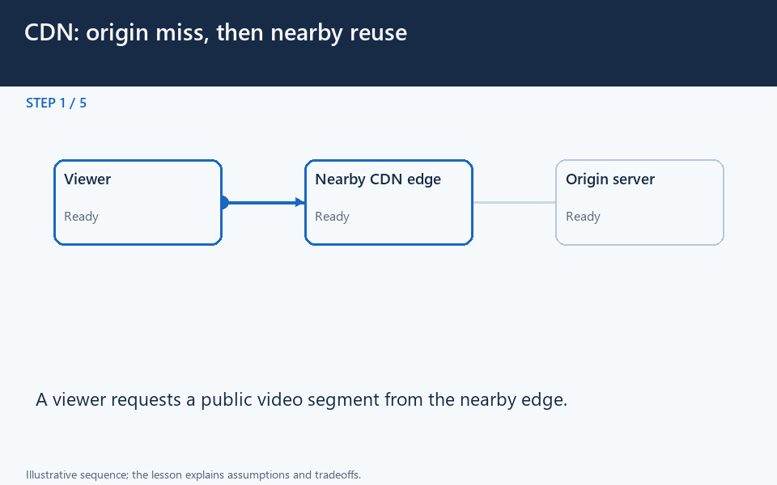

# CDN: origin miss, then nearby reuse

[← Animation index](README.md)

This is one illustrative scenario, not a complete implementation or a simulation of all failure modes. The related lesson explains assumptions and tradeoffs.

Open the looping animation

## Read the same sequence without motion

1. A viewer requests a public video segment from the nearby edge.
2. On a miss, the edge obtains the allowed content from the origin.
3. The edge stores the response according to its caching policy.
4. A later viewer request can be served without another origin fetch.
5. Versions, expiry, and access rules still matter. Private files need protection.

[View all states as still images](../assets/animations/cdn-edge-steps.png)

## Related lessons

- [Content Delivery Network (CDN)](../curriculum/05-caching/05-content-delivery-network-cdn.md)
