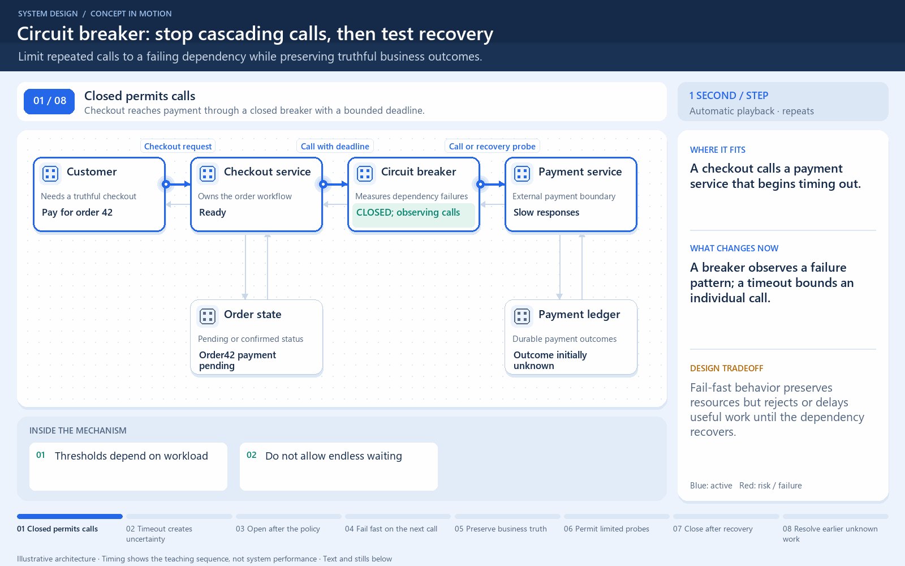

# Circuit breaker: closed, open, half-open

[← Animation index](README.md)

This is one illustrative scenario, not a complete implementation or a simulation of all failure modes. The related lesson explains assumptions and tradeoffs.

Open the looping animation

## Read the same sequence without motion

1. Closed: calls reach the dependency and failures are measured.
2. The configured failure rule opens the circuit.
3. During the open interval, new calls use a safe fallback or fail explicitly.
4. After a delay, half-open allows limited probe calls.
5. Successful probes can close it; failing probes can open it again.

[View all states as still images](../assets/animations/circuit-breaker-steps.png)

## Related lessons

- [Circuit breaker](../curriculum/09-reliability-and-microservices/03-circuit-breaker.md)
