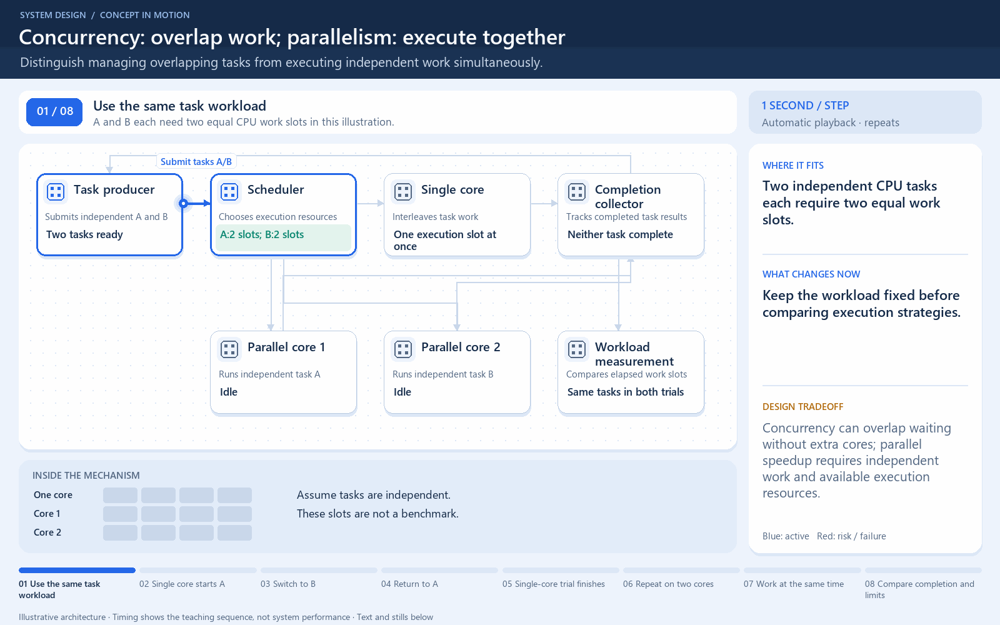

# Interleaving is different from simultaneous execution

[← Animation index](README.md)

This is one illustrative scenario, not a complete implementation or a simulation of all failure modes. The related lesson explains assumptions and tradeoffs.

Open the looping animation

## Read the same sequence without motion

1. One execution unit starts A. Both tasks need two model time units of CPU work.
2. The same execution unit switches to B. Task lifetimes overlap, but work is interleaved.
3. It resumes A, which finishes after its second unit of work.
4. It resumes B. Both tasks finish after four model time units.
5. Separate alternative: two available execution units run A and B at the same time.
6. Both finish after two model units in this idealized CPU-only example.

[View all states as still images](../assets/animations/concurrency-parallelism-steps.png)

## Related lessons

- [Concurrency vs parallelism](../practice/TRADEOFFS.md)
- [Latency vs throughput](../practice/TRADEOFFS.md)
