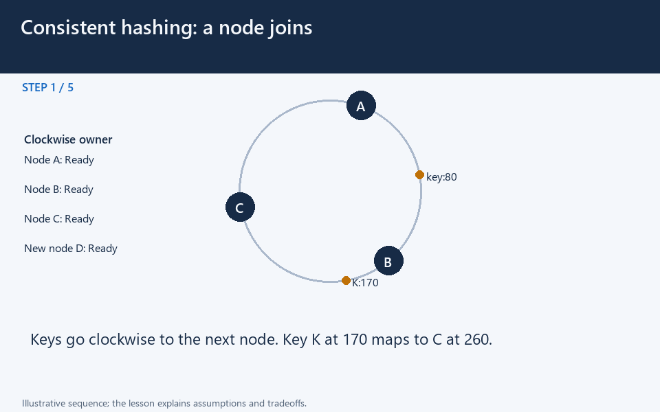

# Consistent hashing: placement and membership changes

[← Animation index](README.md)

**Problem:** Limit key remapping when storage or cache membership changes.

**Scenario:** Illustrative K at 170 moves from C to new node D at 200.

The full system map stays visible as the highlighted path and component states change. Every stage lasts one second and the sequence repeats automatically. Values are illustrative; playback speed is not system timing.

## Read the same sequence without motion

1. **A member joins.** A cache node joins. Which keys must move, and how will clients find the new owners? Reason about this scenario before comparing the mechanism and its consequences.
   Which range changes ownership?; Does a new map move actual data?; What if clients hold an old map?.
2. **Find the old owner.** Key K at 170 reaches C at 260 first; the router sends K's request there. Ownership follows the ring rule even when another server looks physically nearer.
   Clockwise successor owns the key.; K is after B and before C..
3. **See a key that differs.** Key Q at 80 reaches B at 140 and is served independently. Different key positions can have different owners on the same ring.
   The router does not contact all nodes.; Placement does not imply replication..
4. **Add a new member.** D joins at 200, splitting part of C's previous ownership range. A new member changes only its affected successor range under this scheme.
   Changed interval: greater than 140.; Up to and including 200 maps to D.; Other ranges keep their owners..
5. **Move the affected data.** K at 170 moves from C to D; migration must make its data available at the new owner. A new mapping alone does not transfer the stored value.
   Copy data before relying on new owner.; Coordinate writes during migration..
6. **Route using the new view.** The updated router now selects D for K, while Q still belongs to B. The benefit is limited key movement, not a guarantee of perfectly even load.
   Q at 80 still maps to B.; K at 170 now meets D first..
7. **Handle a stale map.** A client using old membership may still contact C, so migration needs a compatibility policy. Membership convergence and data migration are separate operational concerns.
   Use versioning or deliberate forwarding.; Do not assume instant map agreement..
8. **Account for hot keys.** Virtual nodes can balance ranges, but one extremely popular key can still overload its owner. Consistent hashing reduces remapping; it does not remove skew or provide recovery automatically.
   K/N is a balanced-case estimate.; Replicas and hot-key handling are extra.; Observe origin pressure during moves..

**Design tradeoff:** Limited movement reduces disruption, but membership agreement, data transfer, skew, replication, and recovery remain separate responsibilities.

[View all states as still images](../assets/animations/consistent-hash-steps.png)

## Related lessons

- [Consistent Hashing](../curriculum/03-databases/12-consistent-hashing.md)
