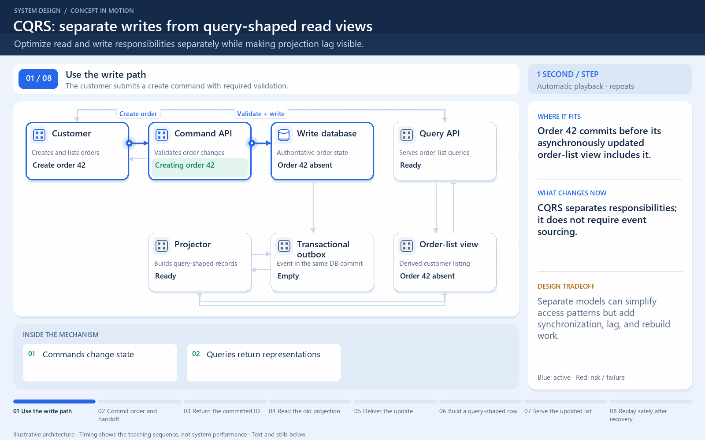

# CQRS: separate writes from query-shaped read views

[← Animation index](README.md)

**Problem:** Optimize read and write responsibilities separately while making projection lag visible.

**Scenario:** Order 42 commits before its asynchronously updated order-list view includes it.

The full system map stays visible as the highlighted path and component states change. Every stage lasts one second and the sequence repeats automatically. Values are illustrative; playback speed is not system timing.

## Read the same sequence without motion

1. **Use the write path.** The customer submits a create command with required validation. CQRS separates responsibilities; it does not require event sourcing.
   Commands change state; Queries return representations.
2. **Commit order and handoff.** Order 42 and its outbox record commit together. The outbox closes one crash gap between a database write and publishing its update.
   Write model remains authoritative; Outbox publication needs recovery.
3. **Return the committed ID.** The command returns order 42 before the projection finishes. Truthful acknowledgement can identify a committed order without claiming every view is current.
   Acceptable lag is a requirement; UI can show a pending view.
4. **Read the old projection.** An immediate list query reads the still-old order-list view. Read-model lag is not proof that the original command failed.
   Do not create another order blindly; A read view is a separate model.
5. **Deliver the update.** The outbox publisher supplies committed E42 to the projector. Projection delivery can repeat; define recoverable progress.
   Event identity is stable; Event sourcing is not required.
6. **Build a query-shaped row.** The projector updates the customer-specific listing. Optimize this view for real queries instead of forcing each screen through write-model joins.
   Include required customer key; Monitor projection lag.
7. **Serve the updated list.** The next query returns order 42 from the read model. A useful read model can be rebuilt; it is not necessarily the primary source of truth.
   State the freshness contract; Bound query result size.
8. **Replay safely after recovery.** A repeated E42 leaves the same listing rather than creating another order row. Separate models create extra operational work; simple CRUD may not need this split.
   Idempotent projection update; Define how to rebuild the view.

**Design tradeoff:** Separate models can simplify access patterns but add synchronization, lag, and rebuild work.

[View all states as still images](../assets/animations/cqrs-steps.png)

## Related lessons

- [Command and Query Responsibility Segregation (CQRS)](../curriculum/08-architectural-patterns/05-command-and-query-responsibility-segregation-cqrs.md)
