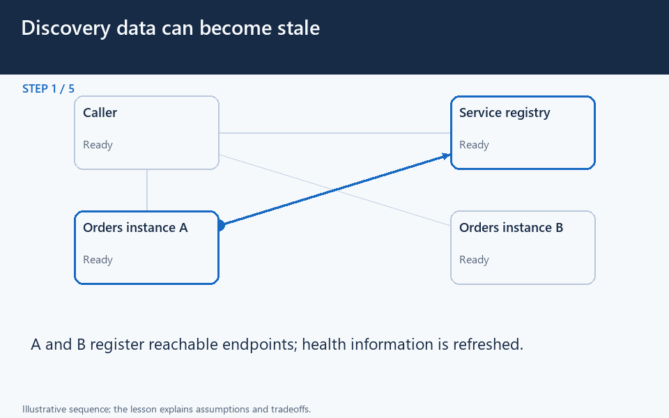

# Discovery data can become stale

[← Animation index](README.md)

This is one illustrative scenario, not a complete implementation or a simulation of all failure modes. The related lesson explains assumptions and tradeoffs.

Open the looping animation

## Read the same sequence without motion

1. A and B register reachable endpoints; health information is refreshed.
2. The caller discovers candidate orders endpoints.
3. A fails after discovery; a previously returned endpoint can now be stale.
4. A health timeout marks A suspect; the registry can stop advertising it.
5. A retry to B must respect the operation retry/idempotency policy.

[View all states as still images](../assets/animations/discovery-heartbeat-steps.png)

## Related lessons

- [Service Discovery](../curriculum/09-reliability-and-microservices/01-service-discovery.md)
- [HeartBeats](../curriculum/09-reliability-and-microservices/02-heartbeats.md)
