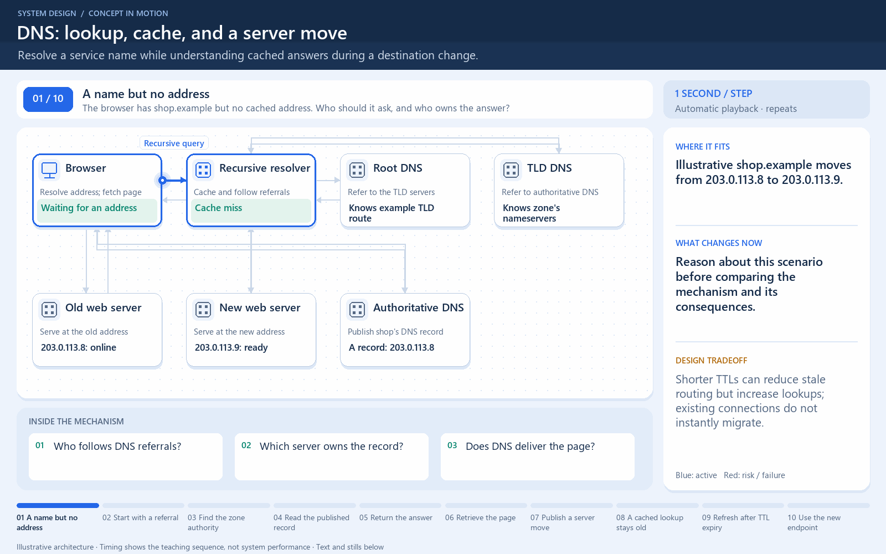

# DNS: a name becomes an address

[← Animation index](README.md)

This is one illustrative scenario, not a complete implementation or a simulation of all failure modes. The related lesson explains assumptions and tradeoffs.

Open the looping animation

## Read the same sequence without motion

1. The browser needs the address for shop.example.
2. On a miss, the resolver follows DNS delegation to the responsible server.
3. The resolver returns the address and caches it for its TTL.
4. The browser can now connect to the web server. DNS did not carry the page.
5. A later lookup may use the cached answer until its TTL expires.

[View all states as still images](../assets/animations/dns-lookup-steps.png)

## Related lessons

- [Domain Name System (DNS)](../curriculum/02-networking/04-domain-name-system-dns.md)
