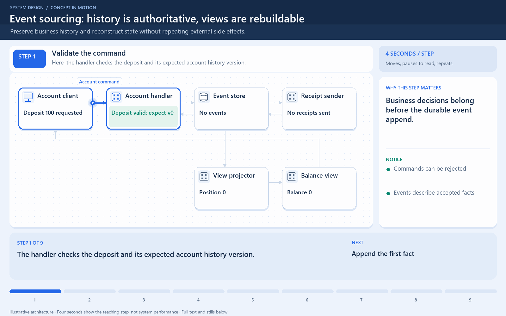

# Event sourcing: history is authoritative, views are rebuildable

[← Animation index](README.md)

**Problem:** Preserve business history and reconstruct state without repeating external side effects.

**Scenario:** An account deposits 100, withdraws 30, then rebuilds a lost balance view.

The full system map stays visible as the highlighted path and component states change. Every stage lasts one second and the sequence repeats automatically. Values are illustrative; playback speed is not system timing.

## Read the same sequence without motion

1. **Validate the command.** The handler checks the deposit and its expected account history version. Business decisions belong before the durable event append.
   Commands can be rejected; Events describe accepted facts.
2. **Append the first fact.** Deposited(100) is durably appended as event one. Concurrent appends need a version or serialization rule, not blind competing histories.
   Event history is authoritative; A notification alone is not sourcing.
3. **Build the current view.** The projector applies event one; the derived balance becomes 100. The balance view is a useful copy, not the only business history.
   Projection may lag; Track its replay position.
4. **Send a live receipt.** An independent sender handles the live event once under its deduplication policy. External actions must not be blindly repeated by a view rebuild.
   Receipt delivery needs recovery; Deduplicate by event identity.
5. **Append the withdrawal.** A valid withdrawal appends event two after version one. Check invariants against authoritative history or serialized aggregate state.
   Withdrawn is a business fact; Version mismatch requires handling.
6. **Derive the new balance.** Applying both events gives the current balance of 70. Stored facts and calculated state are different representations.
   100 minus 30 equals 70; Event schemas remain meaningful.
7. **Lose only the view.** The balance view is lost, but the durable event history survives. A rebuildable projection reduces data-loss risk only when the history itself is protected.
   Back up the event store; Not all storage is disposable.
8. **Replay without side effects.** The projector replays deposit and withdrawal; receipts are not replayed with it. Rebuilds derive state; live side effects require their own explicit processing rules.
   Separate replay from notifications; Snapshots shorten long replays.
9. **Serve the rebuilt result.** The client reads 70 again from the restored view. Event sourcing is useful when historical facts justify its extra evolution and recovery work.
   Verify replay equals prior state; Test old schema versions.

**Design tradeoff:** History enables audit and replay, but schemas, concurrency, snapshots, and side effects need deliberate handling.

[View all states as still images](../assets/animations/event-sourcing-steps.png)

## Related lessons

- [Event Sourcing](../curriculum/08-architectural-patterns/04-event-sourcing.md)
