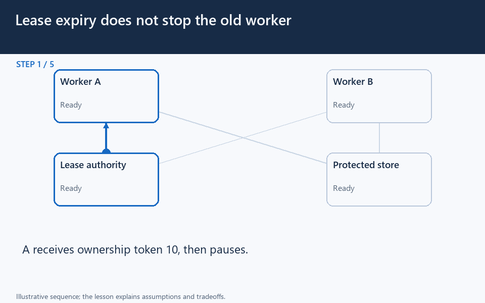

# Lease expiry does not stop the old worker

[← Animation index](README.md)

This is one illustrative scenario, not a complete implementation or a simulation of all failure modes. The related lesson explains assumptions and tradeoffs.

Open the looping animation

## Read the same sequence without motion

1. A receives ownership token 10, then pauses.
2. A lease expires; B acquires a newer token 11.
3. The store accepts B and records the newer fencing token.
4. A resumes and sends a stale write carrying token 10.
5. The store rejects 10 because it enforces fencing. Issuing tokens alone is not enough.

[View all states as still images](../assets/animations/fencing-token-steps.png)

## Related lessons

- [Distributed Locking](../curriculum/09-reliability-and-microservices/07-distributed-locking.md)
