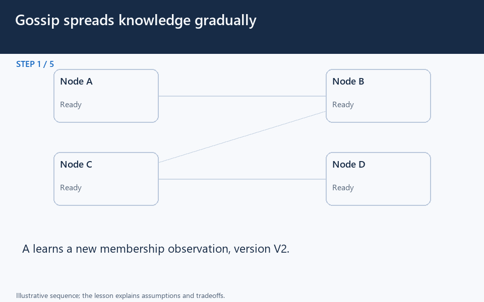

# Gossip: membership spreads without instant agreement

[← Animation index](README.md)

**Problem:** Spread membership observations efficiently while tolerating temporarily different node views.

**Scenario:** A storage node joins while one existing peer is temporarily unreachable.

The full system map stays visible as the highlighted path and component states change. Every stage lasts four seconds: the path moves, then the completed state pauses so you can read it. The sequence repeats automatically. Values are illustrative; playback speed is not system timing.

## Read the same sequence without motion

1. **A local view is not global.** The client asks B for destinations before B has heard about D.
   - **Why it matters:** A useful local answer can still be temporarily incomplete.
   - **Notice:** Each node holds its own view; No global read happens here.
2. **D reaches one peer.** D announces itself to A, creating a newer membership observation.
   - **Why it matters:** One successful announcement does not instantly update every peer.
   - **Notice:** A records versioned information; Other peers still have old views.
3. **A tells B.** A exchanges the newer observation with a selected peer, B.
   - **Why it matters:** Periodic peer exchanges distribute the work of spreading knowledge.
   - **Notice:** Peer selection is protocol-specific; Versions distinguish observations.
4. **B tells C.** B later relays the update, allowing C to learn about D.
   - **Why it matters:** Information travels over multiple exchanges rather than one universal broadcast.
   - **Notice:** C learns through B, not D; Some nodes know before others.
5. **A partition delays E.** C cannot deliver the observation to E while their connection is unavailable.
   - **Why it matters:** A delayed observation is not proof that the remote process has died.
   - **Notice:** E can remain alive but isolated; Local views temporarily disagree.
6. **Communication recovers.** A later successful exchange supplies E with the newer member information.
   - **Why it matters:** Convergence requires communication and the protocol rules to permit state propagation.
   - **Notice:** Newer observations replace older ones; Recovery need not be instantaneous.
7. **Peers resynchronize.** E exchanges state with A, helping reconcile their known observations.
   - **Why it matters:** A reconnecting peer needs version-aware reconciliation, not blind last-arrival wins.
   - **Notice:** Old messages may return after recovery; Conflicts need explicit rules.
8. **Read after propagation.** The client asks B again and can now discover the new node.
   - **Why it matters:** Observe convergence time and message volume before increasing gossip frequency.
   - **Notice:** This spreads membership information; It does not order committed writes.

**Design tradeoff:** More exchanges reduce convergence delay but consume bandwidth; spreading observations does not establish consensus.

[View all states as still images](../assets/animations/gossip-spread-steps.png)

## Related lessons

- [Gossip Protocol](../curriculum/09-reliability-and-microservices/08-gossip-protocol.md)
