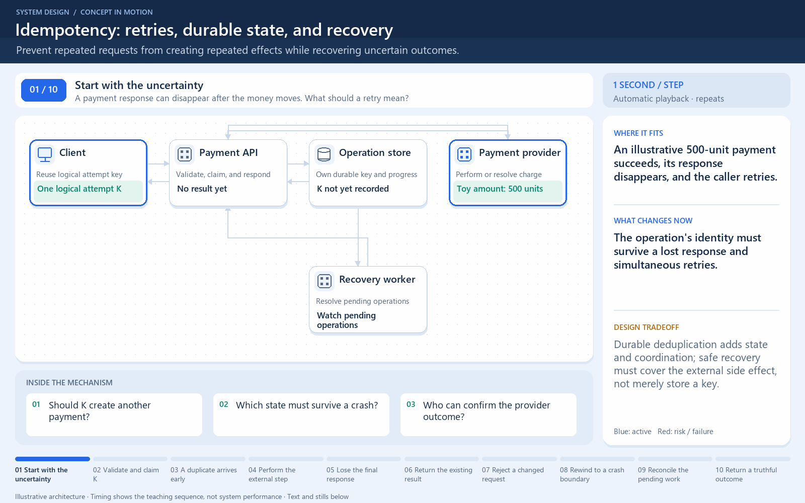

# A lost response must not mean two charges

[← Animation index](README.md)

This is one illustrative scenario, not a complete implementation or a simulation of all failure modes. The related lesson explains assumptions and tradeoffs.

Open the looping animation

## Read the same sequence without motion

1. The client sends one payment attempt with idempotency key K.
2. Atomically associate K with one payment operation and its recoverable result.
3. The response is lost after the operation succeeds.
4. The client retries using K and the same request body.
5. Return or resume the recorded result, rather than create a second charge.

[View all states as still images](../assets/animations/idempotency-steps.png)

## Related lessons

- [Idempotency](../curriculum/06-api-fundamentals/04-idempotency.md)
- [Webhooks](../curriculum/06-api-fundamentals/07-webhooks.md)
- [Reliability](../curriculum/01-core-concepts/05-reliability.md)
