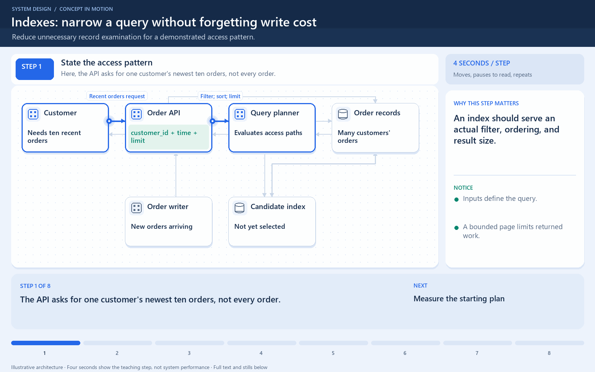

# An index narrows the records to examine

[← Animation index](README.md)

This is one illustrative scenario, not a complete implementation or a simulation of all failure modes. The related lesson explains assumptions and tradeoffs.

Open the looping animation

## Read the same sequence without motion

1. Find orders for customer 7 in a hypothetical table with one million rows.
2. Without a useful access path, the engine may inspect the full table.
3. A suitable index maps customer 7 to candidate records.
4. Read or validate the matching records as required by the execution plan.
5. The index costs storage and write maintenance; measure the actual query plan.

[View all states as still images](../assets/animations/index-lookup-steps.png)

## Related lessons

- [Indexes](../curriculum/03-databases/06-indexes.md)
