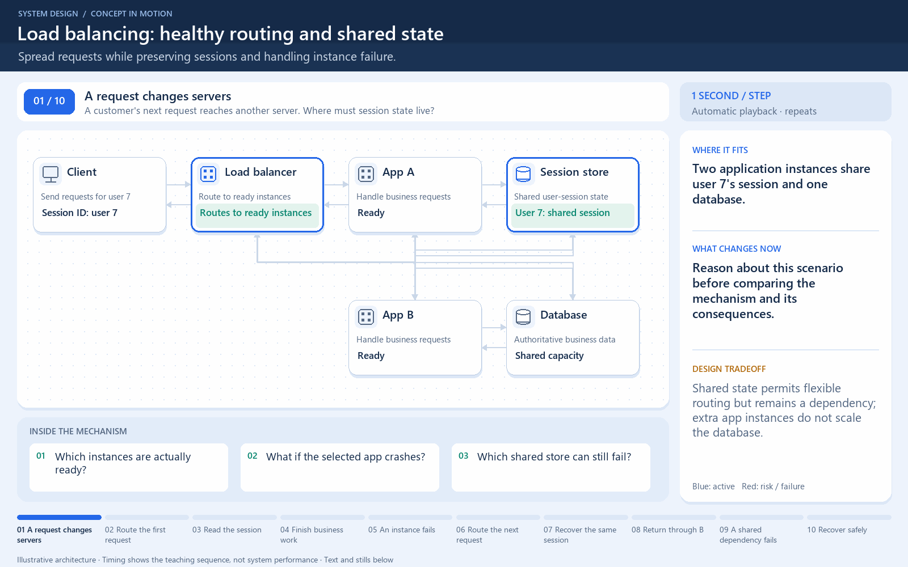

# Scale a service without losing sessions

[← Animation index](README.md)

This is one illustrative scenario, not a complete implementation or a simulation of all failure modes. The related lesson explains assumptions and tradeoffs.

Open the looping animation

## Read the same sequence without motion

1. The client sends a request to the service entry point.
2. The load balancer routes the first request to App A.
3. App A keeps session state outside its own process.
4. A later request can be routed to App B.
5. App B retrieves the session instead of relying on App A memory.
6. More app instances do not remove shared-store bottlenecks or failures.

[View all states as still images](../assets/animations/load-balancer-steps.png)

## Related lessons

- [Scalability](../curriculum/01-core-concepts/02-scalability.md)
- [Load Balancing](../curriculum/02-networking/08-load-balancing.md)
- [Clustering](../curriculum/02-networking/09-clustering.md)
- [Stateful vs stateless design](../practice/TRADEOFFS.md)
