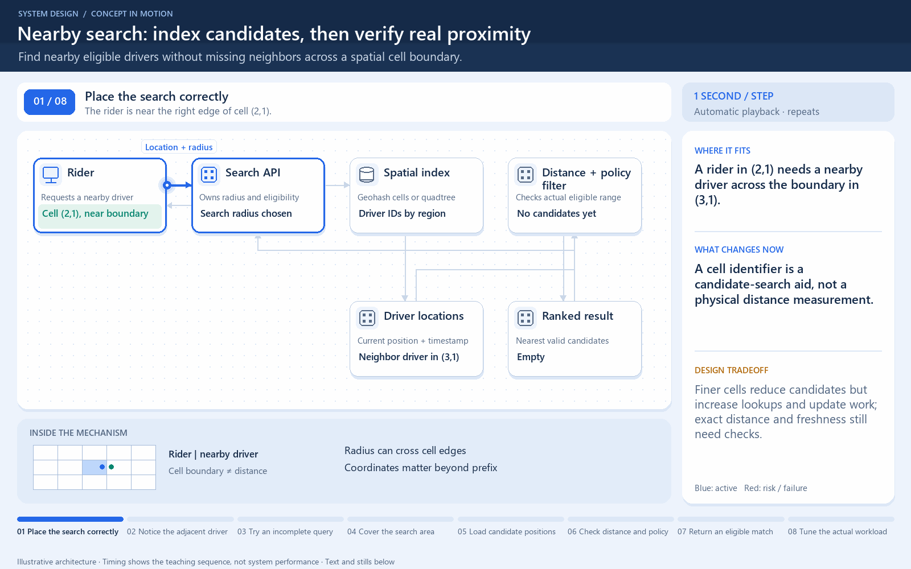

# Nearby search must cross cell boundaries

[← Animation index](README.md)

This is one illustrative scenario, not a complete implementation or a simulation of all failure modes. The related lesson explains assumptions and tradeoffs.

Open the looping animation

## Read the same sequence without motion

1. A rider is close to the edge of cell A.
2. The nearest driver is across the boundary in cell B.
3. Searching only A misses that driver.
4. Search intersecting neighbor cells, then filter by actual distance.
5. Grid prefixes and quadtrees are candidate indexes, not exact distance tests.

[View all states as still images](../assets/animations/nearby-search-steps.png)

## Related lessons

- [Geohashing and Quadtrees](../curriculum/10-security-and-location/04-geohashing-and-quadtrees.md)
