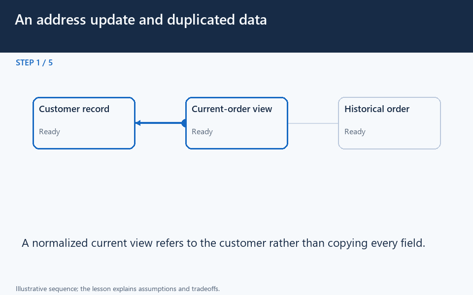

# Normalize current facts; preserve historical snapshots

[← Animation index](README.md)

**Problem:** Choose data ownership and duplication according to the meaning of each fact.

**Scenario:** Customer 7 moves from address A to B after an order shipped to A.

The full system map stays visible as the highlighted path and component states change. Every stage lasts one second and the sequence repeats automatically. Values are illustrative; playback speed is not system timing.

## Read the same sequence without motion

1. **A move after delivery.** A customer moves after an order ships. Which address should current-profile and past-order screens display? Reason about this scenario before comparing the mechanism and its consequences.
   Are these fields the same fact?; Which owner should change?; When should a snapshot be captured?.
2. **Read the current profile.** When the order is created, the service reads customer 7's chosen delivery address A. Capture a purchase fact at a deliberate business boundary.
   Validate the chosen address.; Profile changes later are separate..
3. **Record a reference and fact.** The order stores customer ID 7 and delivery snapshot A as part of its creation. A reference identifies the customer; a snapshot records the order's own historical value.
   These are tables, not separate commits.; Define when the order becomes visible..
4. **Change today's profile.** The customer later updates the profile address from A to B. Updating the current owner need not rewrite historical order data.
   One profile update changes current truth.; Order snapshot still means purchase A..
5. **Display the current value.** The current profile view reads B from its owner rather than maintaining an accidental extra copy. Normalized ownership avoids updating many copies of the same current fact.
   A join or lookup can add read work.; Index and measure real queries..
6. **Display the old delivery.** The past-order view reads snapshot A, correctly preserving where that order was sent. Historical A and current B can both be correct at the same time.
   Different facts need different labels.; Do not infer inconsistency from values..
7. **Avoid a blind propagation.** Changing every address copy to B would corrupt the order's purchase-time meaning. An update policy must follow semantics, not a rule to replace every matching value.
   Corrections need a business policy.; A snapshot is not a stale profile..
8. **Decide on denormalization.** If a live read becomes expensive, consider a derived copy only with an owner and update policy. Denormalization trades read cost for write and propagation complexity.
   Measure queries and indexes first.; Specify acceptable delay for copies.; Preserve separate historical meaning..

**Design tradeoff:** Joins can add read work; duplicated current values need coordinated updates, while historical snapshots intentionally preserve past meaning.

[View all states as still images](../assets/animations/normalization-steps.png)

## Related lessons

- [Normalization and Denormalization](../curriculum/03-databases/07-normalization-and-denormalization.md)
