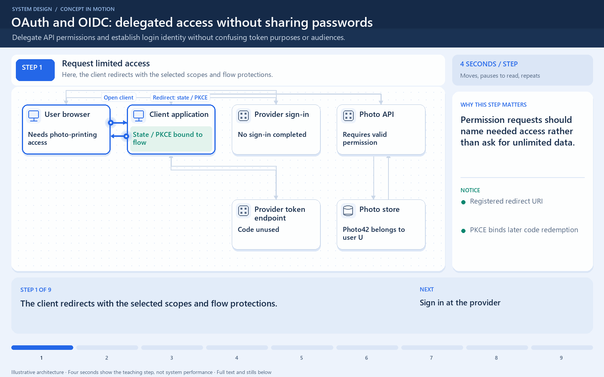

# OAuth and OIDC: delegated access without sharing passwords

[← Animation index](README.md)

**Problem:** Delegate API permissions and establish login identity without confusing token purposes or audiences.

**Scenario:** A photo-printing client signs a user in and requests permitted photos.

The full system map stays visible as the highlighted path and component states change. Every stage lasts four seconds: the path moves, then the completed state pauses so you can read it. The sequence repeats automatically. Values are illustrative; playback speed is not system timing.

## Read the same sequence without motion

1. **Request limited access.** The client redirects with the selected scopes and flow protections.
   - **Why it matters:** Permission requests should name needed access rather than ask for unlimited data.
   - **Notice:** Registered redirect URI; PKCE binds later code redemption.
2. **Sign in at the provider.** The user authenticates at the provider, not by giving the client a password.
   - **Why it matters:** OAuth authorization and user authentication are related but different jobs.
   - **Notice:** Provider handles authentication; User authorizes relevant access.
3. **Return a short-lived code.** The browser returns an authorization code to the registered client callback.
   - **Why it matters:** A callback code is not the access token to present to the photo API.
   - **Notice:** Validate callback state; Do not redeem an unrelated code.
4. **Exchange the code.** The client supplies the code and required verifier or client authentication.
   - **Why it matters:** Exact checks depend on the client type and selected standard flow.
   - **Notice:** Validate code and redirect binding; Client authentication where required.
5. **Validate the login identity.** For OIDC, the client validates the ID token intended for that client.
   - **Why it matters:** An ID token conveys client login identity; it is not a generic API permission token.
   - **Notice:** Check issuer, signature, audience; Check nonce and lifetime as required.
6. **Request the permitted photo.** The client sends the access token to its intended photo API.
   - **Why it matters:** API authorization includes both token permission and the requested object’s ownership.
   - **Notice:** Validate token by its format; Do not substitute an ID token.
7. **Return authorized data.** The API returns the allowed photo through the client.
   - **Why it matters:** Sign-in and token receipt do not prove every object is accessible.
   - **Notice:** Audience targets the resource API; Keep credentials out of logs.
8. **Reject an unrelated photo.** The same signed-in user asks for a photo owned by someone else.
   - **Why it matters:** A valid identity does not grant unlimited access.
   - **Notice:** Scope may not settle ownership; Return a truthful denial.
9. **Respect token lifetime.** Expired access requires an allowed renewal flow or a new authorization.
   - **Why it matters:** Renewal is a defined protocol behavior; refresh credentials are not universally issued.
   - **Notice:** Rotate and protect credentials; Plan logout and revocation behavior.

**Design tradeoff:** Delegation avoids sharing a password but requires redirect, token, lifetime, scope, and ownership validation.

[View all states as still images](../assets/animations/oauth-oidc-steps.png)

## Related lessons

- [OAuth 2.0 and OpenID Connect (OIDC)](../curriculum/10-security-and-location/02-oauth-20-and-openid-connect-oidc.md)
