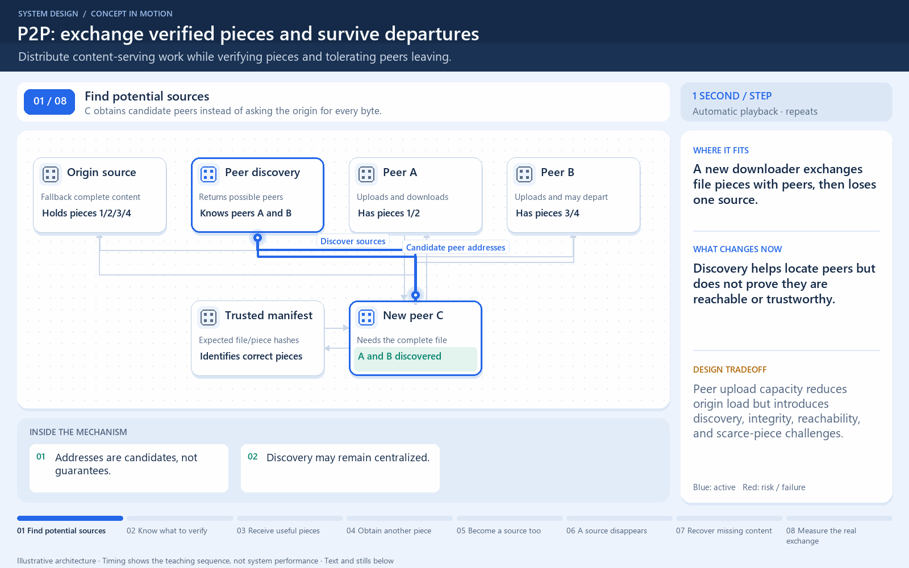

# Peers share verified pieces and may leave

[← Animation index](README.md)

This is one illustrative scenario, not a complete implementation or a simulation of all failure modes. The related lesson explains assumptions and tradeoffs.

Open the looping animation

## Read the same sequence without motion

1. A trusted file description identifies the pieces and their expected digests.
2. C downloads a useful piece from A and verifies it.
3. C obtains another useful piece from B.
4. A leaves before sending piece 2. Discovery must locate another source.
5. Peers reduce origin traffic only when useful sources remain reachable.

[View all states as still images](../assets/animations/p2p-pieces-steps.png)

## Related lessons

- [Peer-to-Peer (P2P) Architecture](../curriculum/08-architectural-patterns/09-peer-to-peer-p2p-architecture.md)
