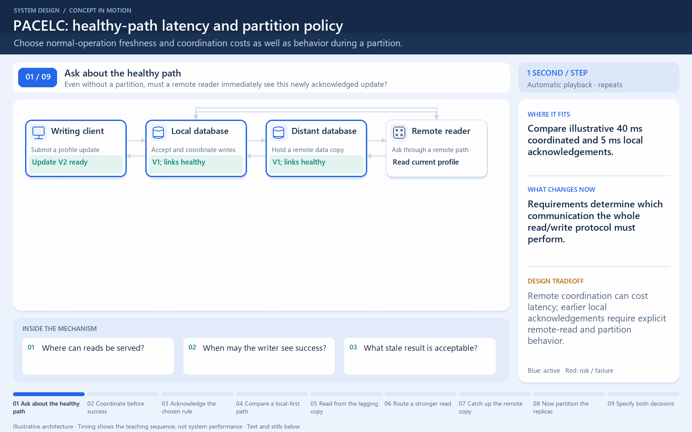

# PACELC: healthy-path latency and partition policy

[← Animation index](README.md)

**Problem:** Choose normal-operation freshness and coordination costs as well as behavior during a partition.

**Scenario:** Compare illustrative 40 ms coordinated and 5 ms local acknowledgements.

The full system map stays visible as the highlighted path and component states change. Every stage lasts four seconds: the path moves, then the completed state pauses so you can read it. The sequence repeats automatically. Values are illustrative; playback speed is not system timing.

## Read the same sequence without motion

1. **Ask about the healthy path.** Even without a partition, must a remote reader immediately see this newly acknowledged update?
   - **Why it matters:** Requirements determine which communication the whole read/write protocol must perform.
   - **Notice:** Where can reads be served; When may the writer see success.
2. **Coordinate before success.** In one illustrative protocol, the local write waits for the remote coordination rule.
   - **Why it matters:** Waiting buys only the guarantees of the complete protocol, not a universal consistency label.
   - **Notice:** Toy coordinated path: 40 ms; Reads must obey matching rules.
3. **Acknowledge the chosen rule.** Remote coordination completes and the writer receives the illustrative 40 ms acknowledgement.
   - **Why it matters:** A distant stage can increase healthy-operation write latency.
   - **Notice:** Required persistence still matters; One remote ACK alone is not a proof.
4. **Compare a local-first path.** Rewind the example: another policy acknowledges local V2 before the remote copy catches up.
   - **Why it matters:** These toy 5 ms and 40 ms values compare policies, not benchmark products.
   - **Notice:** This is an alternative protocol; The remote copy can now lag.
5. **Read from the lagging copy.** A remote read may still return V1 after the earlier local acknowledgement.
   - **Why it matters:** Earlier acknowledgement needs an explicit rule for subsequent reads.
   - **Notice:** A healthy network can still have lag; Choose staleness per operation.
6. **Route a stronger read.** A selected authoritative read path can obtain V2, with its own communication and availability costs.
   - **Why it matters:** Strong reads depend on protocol and routing, not the mere existence of synchronous or asynchronous copies.
   - **Notice:** Account for distance on this path; Do not let arbitrary replicas bypass it.
7. **Catch up the remote copy.** The asynchronous stream eventually applies V2 on the distant database.
   - **Why it matters:** Propagation and read rules together determine observable freshness.
   - **Notice:** Measure lag and response percentiles; Successful propagation is required.
8. **Now partition the replicas.** When communication stops, decide whether the next operation can complete without required coordination.
   - **Why it matters:** Partition availability versus consistency is a different question from healthy-path latency.
   - **Notice:** Some operations may refuse or wait; Others may accept stale/local behavior.
9. **Specify both decisions.** Document partition behavior and normal-operation latency/freshness for the actual operations and protocol.
   - **Why it matters:** PACELC prompts both failure-path and healthy-path reasoning.
   - **Notice:** Measure the chosen policy's cost; Avoid a universal SQL/NoSQL shortcut.

**Design tradeoff:** Remote coordination can cost latency; earlier local acknowledgements require explicit remote-read and partition behavior.

[View all states as still images](../assets/animations/pacelc-steps.png)

## Related lessons

- [PACELC Theorem](../curriculum/04-distributed-data/02-pacelc-theorem.md)
