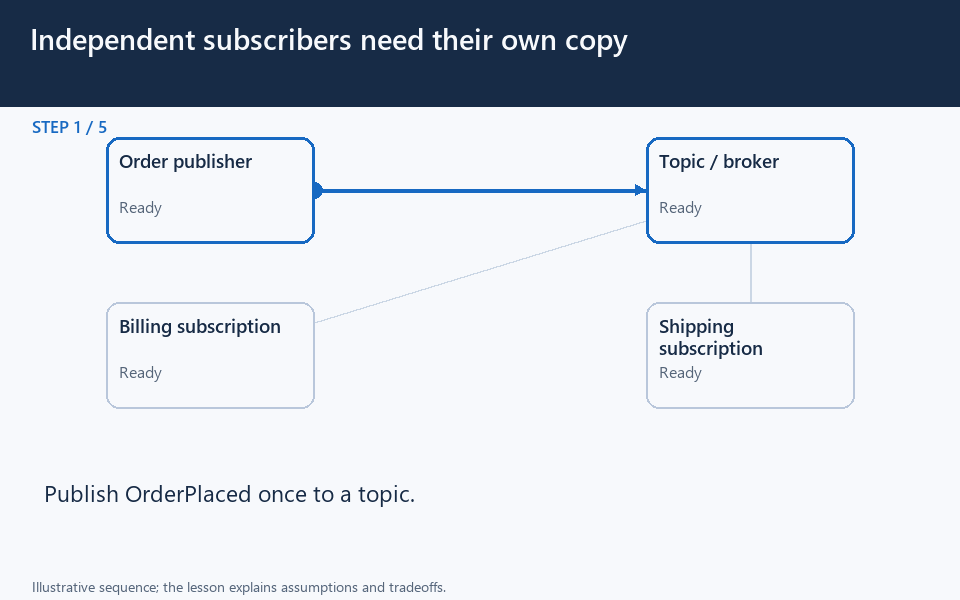

# Pub/sub: one event, independent business reactions

[← Animation index](README.md)

**Problem:** Let independent consumers react to an order without sharing one competing-work queue.

**Scenario:** Billing and shipping must each process OrderPlaced, even if one is temporarily offline.

The full system map stays visible as the highlighted path and component states change. Every stage lasts four seconds: the path moves, then the completed state pauses so you can read it. The sequence repeats automatically. Values are illustrative; playback speed is not system timing.

## Read the same sequence without motion

1. **Publish the business fact.** The order service publishes E42 with a stable event identity.
   - **Why it matters:** Coordinate the order record and publish handoff; an outbox can bridge that failure boundary.
   - **Notice:** OrderPlaced has defined meaning; Version fields deliberately.
2. **Fan out logically.** Billing and shipping each receive independent delivery state.
   - **Why it matters:** Fan-out differs from workers competing for one shared job.
   - **Notice:** Each subscription owns progress; Push or pull depends on product.
3. **Pick one billing worker.** A worker receives the billing delivery and begins its action.
   - **Why it matters:** Multiple workers may share one subscription without stealing shipping’s event.
   - **Notice:** Bound concurrent work; Handle repeated deliveries safely.
4. **Commit billing once.** The billing worker records its effect and acknowledges.
   - **Why it matters:** An acknowledgement follows the durable effect under the chosen processing contract.
   - **Notice:** Event ID supports deduplication; Billing has its own retry policy.
5. **Shipping is still behind.** Shipping is offline while billing is already finished.
   - **Why it matters:** Offline catch-up requires suitable durability or retained history; ephemeral broadcast is insufficient.
   - **Notice:** Lag differs per subscriber; Retention has a finite policy.
6. **Resume the slow subscriber.** Shipping returns and receives its retained event.
   - **Why it matters:** One slow independent consumer need not block unrelated completed billing work.
   - **Notice:** Resume from stored progress; Check ordering requirements.
7. **Record the second reaction.** Shipping records its effect and acknowledges its own delivery.
   - **Why it matters:** Two expected business reactions are not duplicate handling of one queue job.
   - **Notice:** Each effect needs recovery; Global ordering is not automatic.
8. **Inspect the complete path.** Both subscriptions completed independently with explicit recovery behavior.
   - **Why it matters:** Measure subscriber lag and failures separately rather than reporting one generic event-success count.
   - **Notice:** Keep contracts stable; Bound retries; inspect poison events.

**Design tradeoff:** Independent subscriptions decouple consumers but require retention, retry, ordering, and schema rules.

[View all states as still images](../assets/animations/pub-sub-steps.png)

## Related lessons

- [Publish-Subscribe](../curriculum/07-asynchronous-communication/03-publish-subscribe.md)
- [Event-Driven Architecture (EDA)](../curriculum/08-architectural-patterns/03-event-driven-architecture-eda.md)
