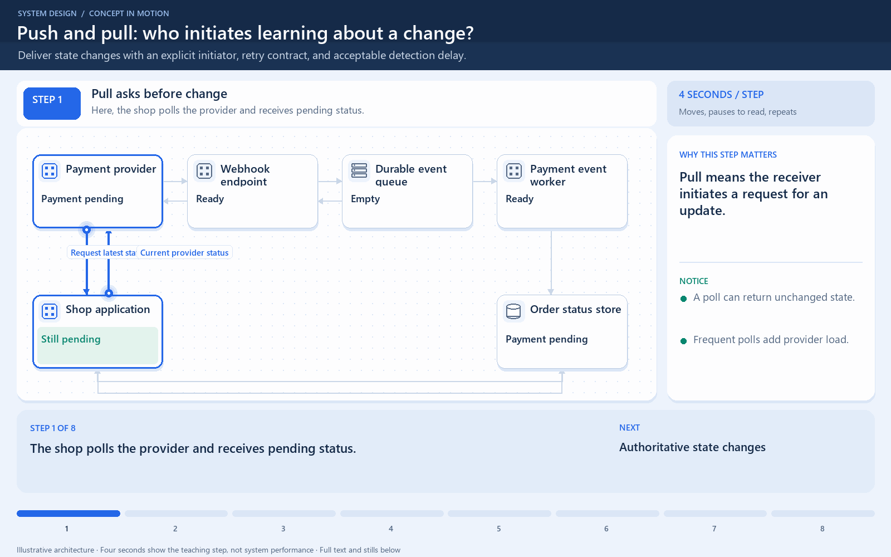

# Push and pull: who initiates learning about a change?

[← Animation index](README.md)

**Problem:** Deliver state changes with an explicit initiator, retry contract, and acceptable detection delay.

**Scenario:** A shop learns whether a payment finished using polling or a webhook.

The full system map stays visible as the highlighted path and component states change. Every stage lasts one second and the sequence repeats automatically. Values are illustrative; playback speed is not system timing.

## Read the same sequence without motion

1. **Pull asks before change.** The shop polls the provider and receives pending status. Pull means the receiver initiates a request for an update.
   A poll can return unchanged state.; Frequent polls add provider load..
2. **Authoritative state changes.** The provider completes the payment before the shop necessarily learns about it. A change happening and a consumer detecting it are separate events.
   Polling delay depends on its schedule.; No delivery method is instantaneous..
3. **Push initiates a delivery.** The provider sends a webhook event to the shop's registered endpoint. Push means the sender initiates this notification, not that a permanent connection is required.
   Verify the provider signature.; Validate event type and identifier..
4. **Accept before acknowledging.** The endpoint safely accepts processing work before returning its chosen acknowledgement. Acknowledging too early can lose work if the receiver then crashes.
   The handler need not finish all work.; Durable acceptance has a defined point..
5. **Apply the business effect.** A worker updates the order view using duplicate-safe event handling. Webhook delivery does not replace authorization or business-state checks.
   Event IDs help recognize repeats.; Events can be delayed or reordered..
6. **A receipt can be lost.** The provider may resend the same event if acknowledgement was not observed. Retrying delivery must not repeat the logical payment effect.
   A successful first attempt can repeat.; Checking only in memory is fragile..
7. **Read what the shop knows.** The application reads its local status, which may lag the provider. A pushed event can still wait in a queue before becoming a readable local result.
   Monitor event processing age.; Distinguish source and local truth..
8. **Compare with another poll.** Polling remains a possible alternative or recovery check under the provider contract. Choose detection delay, rate limits, delivery reliability, and operational complexity together.
   Push avoids many unchanged polls.; Pull controls when the receiver asks..

**Design tradeoff:** Push can reduce unnecessary polls but needs trustworthy delivery and retries; pull trades polling load for detection delay.

[View all states as still images](../assets/animations/push-pull-steps.png)

## Related lessons

- [Push vs pull](../practice/TRADEOFFS.md)
