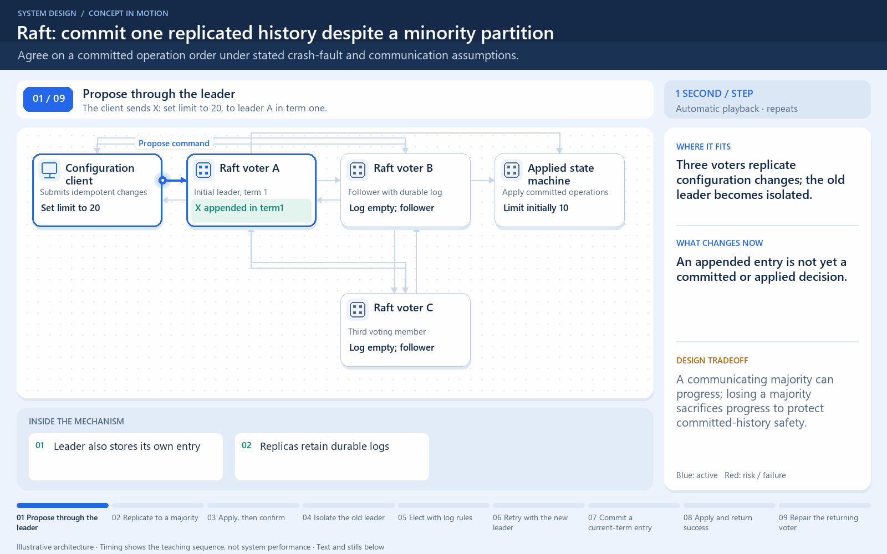

# Raft: commit one replicated history despite a minority partition

[← Animation index](README.md)

**Problem:** Agree on a committed operation order under stated crash-fault and communication assumptions.

**Scenario:** Three voters replicate configuration changes; the old leader becomes isolated.

The full system map stays visible as the highlighted path and component states change. Every stage lasts four seconds: the path moves, then the completed state pauses so you can read it. The sequence repeats automatically. Values are illustrative; playback speed is not system timing.

## Read the same sequence without motion

1. **Propose through the leader.** The client sends X: set limit to 20, to leader A in term one.
   - **Why it matters:** An appended entry is not yet a committed or applied decision.
   - **Notice:** Leader also stores its own entry; Replicas retain durable logs.
2. **Replicate to a majority.** B durably acknowledges X; A and B form two of three voters.
   - **Why it matters:** Raft commits current-term entries using its majority and log rules, not arbitrary voting on values.
   - **Notice:** A counts in the majority; Entry term matters for commit.
3. **Apply, then confirm.** A applies committed X and returns the committed result.
   - **Why it matters:** Committed history drives deterministic state-machine application.
   - **Notice:** Replication is not application; Do not confirm uncommitted writes.
4. **Isolate the old leader.** A appends Y: set limit to 30, but cannot contact a majority.
   - **Why it matters:** A minority cannot safely commit new entries just because its process is still running.
   - **Notice:** Old leader may not know immediately; Do not count missing acknowledgements.
5. **Elect with log rules.** B gets its own vote and C’s eligible vote in a newer term.
   - **Why it matters:** Election requires majority votes and an up-to-date-log check.
   - **Notice:** B retains the committed X; Timing affects election start.
6. **Retry with the new leader.** The client retries the idempotent set; B appends Y in term two.
   - **Why it matters:** The new leader may need to repair follower log prefixes before replication succeeds.
   - **Notice:** Old term1 Y was not committed; Keep the client operation identity.
7. **Commit a current-term entry.** C acknowledges; B and C form a majority for term-two Y.
   - **Why it matters:** Quorum contact alone is insufficient: Raft’s term and log conditions still apply.
   - **Notice:** Majority is two of three here; This is a crash-fault example.
8. **Apply and return success.** B applies Y and confirms the new limit of 30.
   - **Why it matters:** Safety preserves one committed order while the isolated minority cannot progress.
   - **Notice:** Read guarantees need separate choices; No Byzantine-fault tolerance claim.
9. **Repair the returning voter.** A learns the newer term and replaces its conflicting uncommitted suffix.
   - **Why it matters:** Raft can discard conflicting uncommitted entries; committed history must not be overwritten.
   - **Notice:** A steps down on newer term; Membership changes need special rules.

**Design tradeoff:** A communicating majority can progress; losing a majority sacrifices progress to protect committed-history safety.

[View all states as still images](../assets/animations/raft-majority-steps.png)

## Related lessons

- [Consensus Algorithms](../curriculum/09-reliability-and-microservices/06-consensus-algorithms.md)
