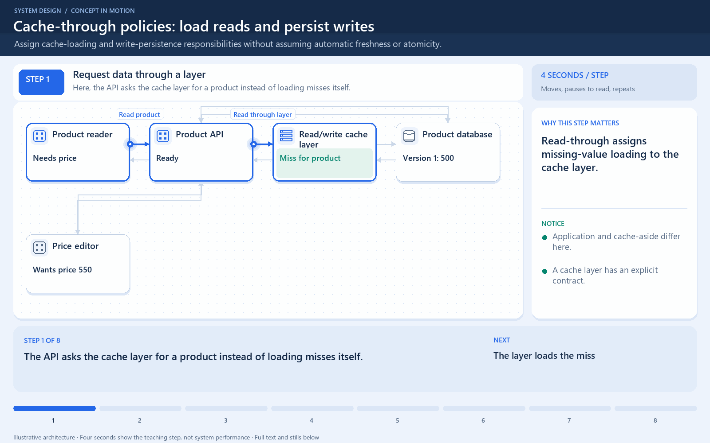

# Read-through and write-through can be combined

[← Animation index](README.md)

This is one illustrative scenario, not a complete implementation or a simulation of all failure modes. The related lesson explains assumptions and tradeoffs.

Open the looping animation

## Read the same sequence without motion

1. Read-through: the application asks the cache layer for a missing value.
2. The cache layer loads it from the backing database.
3. The layer caches V1 and returns it to the application.
4. Write-through: the application sends a new value through that layer.
5. The layer synchronously persists the write according to its write policy.
6. After the required writes succeed, acknowledge. Failure ordering still needs a policy.

[View all states as still images](../assets/animations/read-write-through-steps.png)

## Related lessons

- [Read-through vs write-through cache](../practice/TRADEOFFS.md)
