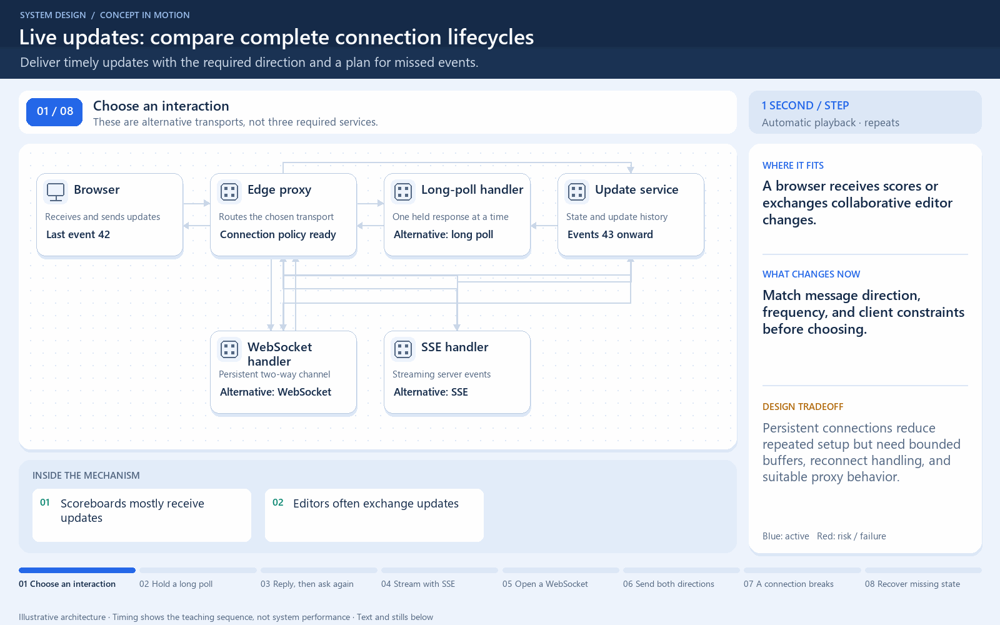

# Live updates: compare complete connection lifecycles

[← Animation index](README.md)

**Problem:** Deliver timely updates with the required direction and a plan for missed events.

**Scenario:** A browser receives scores or exchanges collaborative editor changes.

The full system map stays visible as the highlighted path and component states change. Every stage lasts four seconds: the path moves, then the completed state pauses so you can read it. The sequence repeats automatically. Values are illustrative; playback speed is not system timing.

## Read the same sequence without motion

1. **Choose an interaction.** These are alternative transports, not three required services.
   - **Why it matters:** Match message direction, frequency, and client constraints before choosing.
   - **Notice:** Scoreboards mostly receive updates; Editors often exchange updates.
2. **Hold a long poll.** The browser sends a request; the server holds its response.
   - **Why it matters:** A server update still needs an outstanding client request in this pattern.
   - **Notice:** Timeout ends a held request; The next request must be opened.
3. **Reply, then ask again.** An update completes the response; the browser starts the next poll.
   - **Why it matters:** Repeated waiting requests emulate timely push without one permanently duplex channel.
   - **Notice:** Response and renewal are separate; Include missed-event recovery.
4. **Stream with SSE.** In the SSE alternative, one HTTP response carries successive server events.
   - **Why it matters:** SSE is a server-to-client event stream, not a bidirectional message channel.
   - **Notice:** Client sends initial HTTP request; Proxy must support streaming.
5. **Open a WebSocket.** In the WebSocket alternative, setup creates a persistent two-way channel.
   - **Why it matters:** Connection setup and application message meaning are separate concerns.
   - **Notice:** Authentication still required; Connections consume server resources.
6. **Send both directions.** The browser submits an edit; the service sends its resulting update.
   - **Why it matters:** One channel can carry independent messages in both directions.
   - **Notice:** Do not block all slow clients; Bound queued bytes per connection.
7. **A connection breaks.** The browser disconnects; transport alone cannot preserve unseen events.
   - **Why it matters:** A live channel is not itself a durable message history.
   - **Notice:** Some updates arrive during outage; Retry storms need backoff.
8. **Recover missing state.** After backoff, the browser requests events after 44 or reloads a snapshot.
   - **Why it matters:** Define recovery at the application level, regardless of transport.
   - **Notice:** History may be unavailable; Measure delivery lag and reconnects.

**Design tradeoff:** Persistent connections reduce repeated setup but need bounded buffers, reconnect handling, and suitable proxy behavior.

[View all states as still images](../assets/animations/realtime-protocols-steps.png)

## Related lessons

- [Long polling, WebSockets, Server-Sent Events (SSE)](../curriculum/06-api-fundamentals/06-long-polling-websockets-server-sent-events-sse.md)
- [Long polling vs WebSockets](../practice/TRADEOFFS.md)
