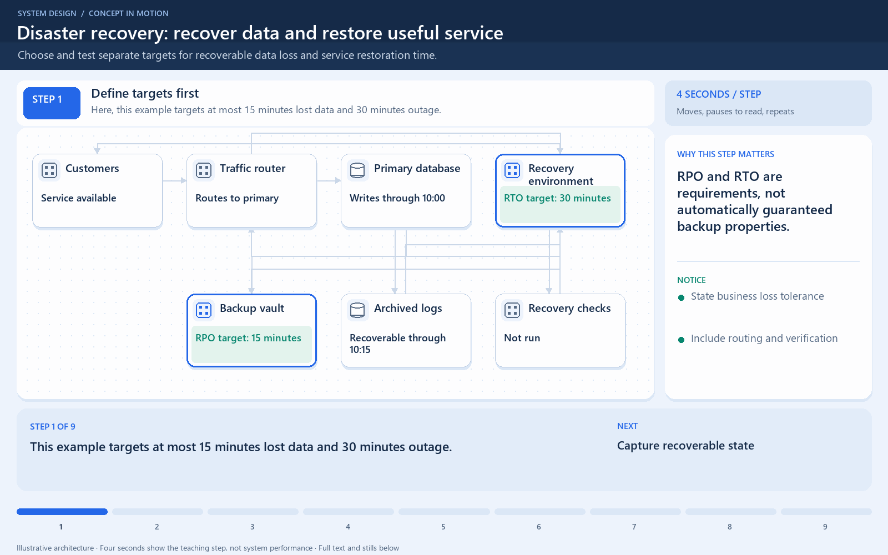

# Disaster recovery: recover data and restore useful service

[← Animation index](README.md)

**Problem:** Choose and test separate targets for recoverable data loss and service restoration time.

**Scenario:** A regional outage follows a 10:00 backup and logs recoverable through 10:15.

The full system map stays visible as the highlighted path and component states change. Every stage lasts four seconds: the path moves, then the completed state pauses so you can read it. The sequence repeats automatically. Values are illustrative; playback speed is not system timing.

## Read the same sequence without motion

1. **Define targets first.** This example targets at most 15 minutes lost data and 30 minutes outage.
   - **Why it matters:** RPO and RTO are requirements, not automatically guaranteed backup properties.
   - **Notice:** State business loss tolerance; Include routing and verification.
2. **Capture recoverable state.** A snapshot reaches the vault; later logs are archived through 10:15.
   - **Why it matters:** Recoverability requires usable copies that survive the same disaster.
   - **Notice:** Protect backup independence; Test actual restoration.
3. **The region fails at 10:20.** Customers lose primary service; newer data lacks a recoverable log copy.
   - **Why it matters:** The outage clock begins at loss of useful service.
   - **Notice:** No recoverable logs after 10:15; Loss depends on recoverable data.
4. **Backup alone misses target.** Restoring only the 10:00 snapshot risks twenty minutes of lost changes.
   - **Why it matters:** The snapshot-only recovery point misses this example’s fifteen-minute loss target.
   - **Notice:** 10:20 minus 10:00 = 20 minutes; Backup existence is not enough.
5. **Replay available logs.** Logs advance restored state to 10:15, leaving five minutes potentially lost.
   - **Why it matters:** The achieved recovery point meets the chosen RPO here; it is not the target’s definition.
   - **Notice:** 10:20 minus 10:15 = 5 minutes; Replay needs intact compatible logs.
6. **Restore the whole service.** Application configuration and database restoration finish at 10:50.
   - **Why it matters:** Files restored does not necessarily mean users can complete checkout.
   - **Notice:** Credentials and configuration matter; Dependency access must work.
7. **Validate before routing.** Recovery checks test useful requests and data invariants.
   - **Why it matters:** Exercise real business behavior rather than relying only on a process-is-running signal.
   - **Notice:** Verify application and data; Do not route to an unready restore.
8. **Switch traffic at 11:00.** Customers regain service forty minutes after the outage began.
   - **Why it matters:** The observed forty-minute recovery misses this example’s thirty-minute RTO.
   - **Notice:** RPO met; RTO missed; Targets and observations differ.
9. **Improve the right mechanism.** More recoverable capture affects loss; faster rehearsed recovery affects downtime.
   - **Why it matters:** Choose improvements by the missed business target, not the number of backup files.
   - **Notice:** Measure end-to-end recovery; Repeat disaster exercises.

**Design tradeoff:** More recoverable logs reduce potential data loss; faster tested restoration reduces outage time, usually at extra cost.

[View all states as still images](../assets/animations/recovery-objectives-steps.png)

## Related lessons

- [Disaster recovery](../curriculum/09-reliability-and-microservices/05-disaster-recovery.md)
