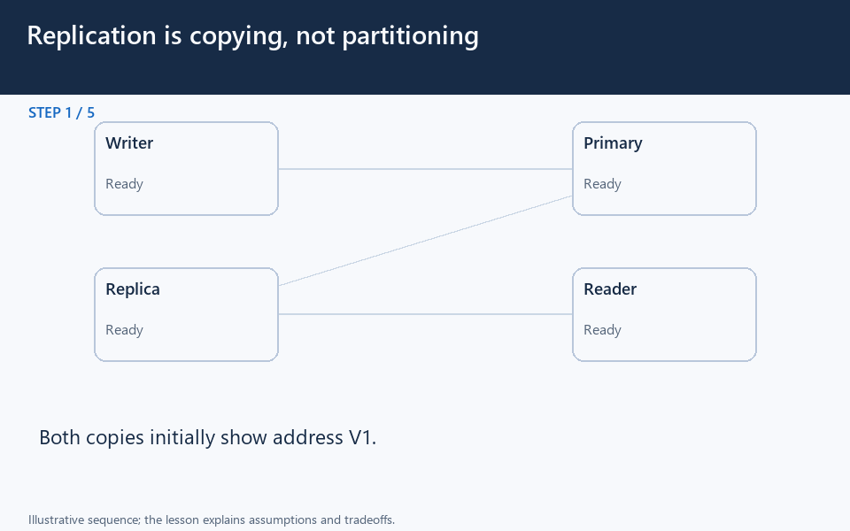

# Replication is copying, not partitioning

[← Animation index](README.md)

This is one illustrative scenario, not a complete implementation or a simulation of all failure modes. The related lesson explains assumptions and tradeoffs.

Open the looping animation

## Read the same sequence without motion

1. Both copies initially show address V1.
2. A write commits V2 on the primary.
3. Before replication applies, a replica read can still return V1.
4. The replication stream applies the update on the replica.
5. Both now show V2. Deletions can replicate too; replication is not a backup.

[View all states as still images](../assets/animations/replication-steps.png)

## Related lessons

- [Database Replication](../curriculum/03-databases/10-database-replication.md)
- [Strong vs eventual consistency](../practice/TRADEOFFS.md)
