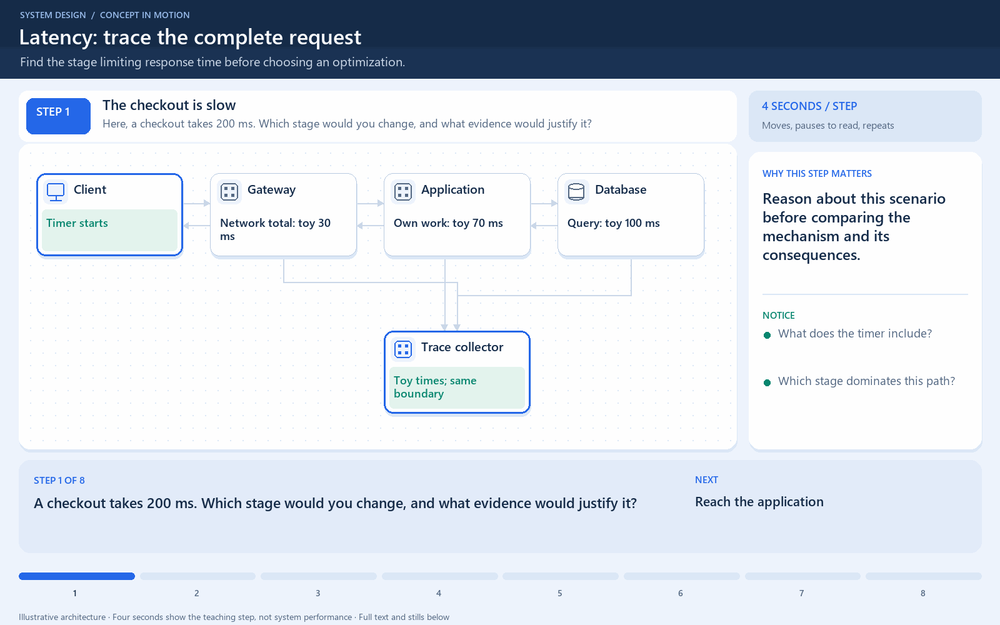

# Latency: trace the complete request

[← Animation index](README.md)

**Problem:** Find the stage limiting response time before choosing an optimization.

**Scenario:** Illustrative sequential request: 30 ms network, 70 ms application, 100 ms database.

The full system map stays visible as the highlighted path and component states change. Every stage lasts one second and the sequence repeats automatically. Values are illustrative; playback speed is not system timing.

## Read the same sequence without motion

1. **The checkout is slow.** A checkout takes 200 ms. Which stage would you change, and what evidence would justify it? Reason about this scenario before comparing the mechanism and its consequences.
   What does the timer include?; Which stage dominates this path?; Does more bandwidth help here?.
2. **Reach the application.** The gateway routes the request; connection and network costs belong in the full path. A fast server-only timer can hide client-observed delay.
   Gateway and app have different roles.; Return travel also belongs in timing..
3. **Do application work.** The application performs 70 ms of its own work, then needs database data. Optimize the critical path, not a conveniently visible component.
   Query depends on preceding work.; Dependent stages cannot overlap..
4. **Complete the first query.** The 100 ms query finishes; the application can build its response. For this sequential example: 30 + 70 + 100 = 200 ms.
   Network budget: 30 ms total.; Own application work: 70 ms.; Query: 100 ms..
5. **Locate the dominant stage.** A trace links stages; investigate the database rather than guessing that bandwidth is slow. Parent spans can include child time; avoid counting it twice.
   Inspect the actual query plan.; Do not sum overlapping spans.; Measure errors alongside latency..
6. **Apply a useful index.** A suitable index reduces the illustrative query from 100 ms to 25 ms. Change the measured bottleneck, then check its costs.
   Index avoids unnecessary row work.; Index writes consume extra work.; This is not a benchmark promise..
7. **Measure the new result.** The same path now totals 125 ms, a 37.5% reduction in this example. Lower request latency and higher throughput are separate measurements.
   30 + 70 + 25 = 125 ms.; 75 / 200 = 37.5% saved.; Keep workload and boundary comparable..
8. **Watch overload separately.** More arrivals than capacity build a queue, even after the query improves. Adding concurrency does not guarantee more completed requests.
   Use stable averages for Little's Law.; Tail latency reveals slow requests.; Bound work or add useful capacity..

**Design tradeoff:** An index can shorten reads but adds storage and write maintenance; more concurrency can increase waiting.

[View all states as still images](../assets/animations/request-latency-steps.png)

## Related lessons

- [Latency vs Throughput vs Bandwidth](../curriculum/01-core-concepts/04-latency-vs-throughput-vs-bandwidth.md)
- [Distributed Tracing](../curriculum/09-reliability-and-microservices/09-distributed-tracing.md)
- [Latency vs throughput](../practice/TRADEOFFS.md)
