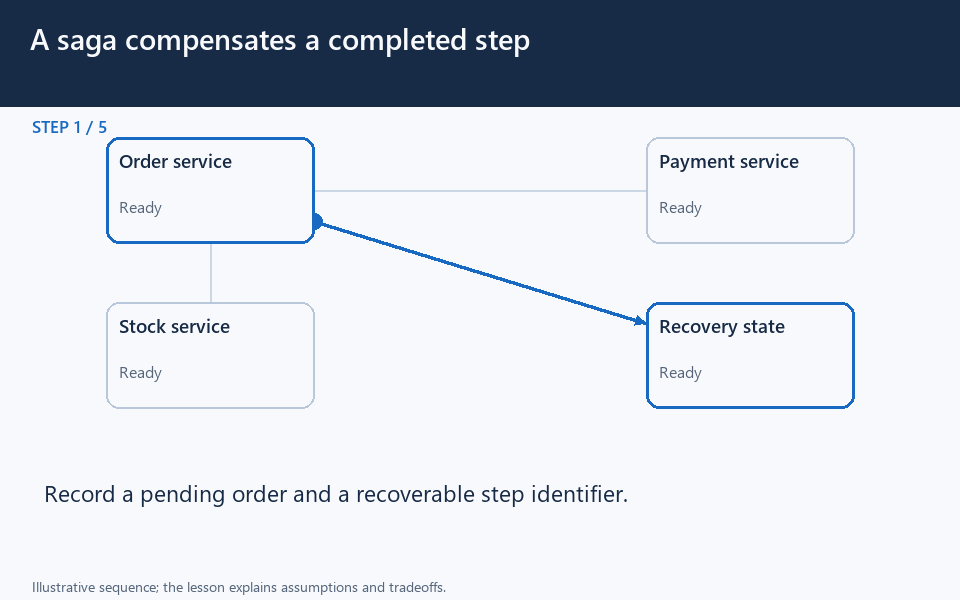

# Saga: local commits and compensating recovery

[← Animation index](README.md)

**Problem:** Recover a multi-service operation when an earlier committed step must be compensated.

**Scenario:** An order charges once, stock is unavailable, and a refund response is lost.

The full system map stays visible as the highlighted path and component states change. Every stage lasts four seconds: the path moves, then the completed state pauses so you can read it. The sequence repeats automatically. Values are illustrative; playback speed is not system timing.

## Read the same sequence without motion

1. **Begin with a business risk.** What should happen if charging succeeds but the later stock reservation cannot complete?
   - **Why it matters:** Each service has its own commit boundary; partial success must be represented honestly.
   - **Notice:** Which step can be compensated; What must survive a coordinator crash.
2. **Persist a pending order.** The coordinator records the order and recoverable step identifiers before advancing.
   - **Why it matters:** A durable workflow can distinguish accepted work from a fully finished purchase.
   - **Notice:** Record stable operation identifiers; Persist progress at deliberate boundaries.
3. **Charge once and record it.** The payment operation succeeds; the coordinator durably records that completed local step.
   - **Why it matters:** An earlier local commit does not disappear when a different service later fails.
   - **Notice:** Provider must support safe retry behavior; Record the returned operation result.
4. **Stock reservation fails.** The stock service reports no inventory, so the charged order cannot proceed normally.
   - **Why it matters:** A saga must define compensation for already completed effects.
   - **Notice:** The charge still exists; This is not one database rollback.
5. **Record the refund intent.** The coordinator persists a refund-needed state with a stable compensation identifier.
   - **Why it matters:** Intent must remain recoverable if the process stops before the next call.
   - **Notice:** Compensation can fail or take time; Do not claim completion prematurely.
6. **Lose the refund response.** The provider refunds under key RK, but its result does not reach the coordinator.
   - **Why it matters:** A timeout is not proof that the refund did not happen.
   - **Notice:** This provider dedupes refund key RK; Keep the uncertain state durable.
7. **Resume from durable state.** The recovery worker finds the unfinished saga and resumes the same compensation, not a new logical refund.
   - **Why it matters:** Safe recovery follows durable progress rather than in-memory assumptions.
   - **Notice:** Crash recovery can repeat commands; Reuse the same compensation identifier.
8. **Confirm the same refund.** A retry or status lookup confirms RK's existing result, which the coordinator records.
   - **Why it matters:** The provider contract and local recovery state must agree on the operation's identity.
   - **Notice:** No second logical refund is requested; Reconcile outcomes that remain unclear.
9. **Report the truthful result.** The customer sees the order failed and its payment was refunded; some external effects may still remain.
   - **Why it matters:** Compensation restores a business outcome; it is not time travel or erasure of every side effect.
   - **Notice:** A receipt email may still exist; Keep operational history for diagnosis.

**Design tradeoff:** Local commits avoid one global transaction but expose intermediate states and require durable retries, reconciliation, and compensation.

[View all states as still images](../assets/animations/saga-steps.png)

## Related lessons

- [Distributed Transactions](../curriculum/04-distributed-data/03-distributed-transactions.md)
- [Reliability](../curriculum/01-core-concepts/05-reliability.md)
