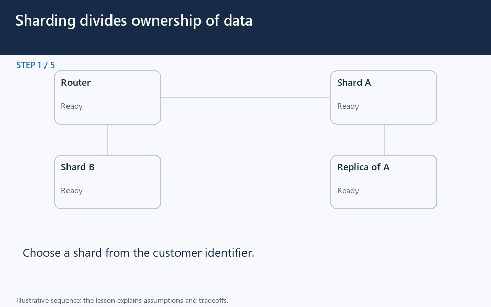

# Sharding: route by ownership, then handle growth

[← Animation index](README.md)

**Problem:** Divide a dataset while accounting for routing, replication, hot shards, and cross-shard queries.

**Scenario:** Illustrative customer ranges 1-1000 and 1001-2000 live on different shards.

The full system map stays visible as the highlighted path and component states change. Every stage lasts one second and the sequence repeats automatically. Values are illustrative; playback speed is not system timing.

## Read the same sequence without motion

1. **Outgrow one database.** Customer traffic outgrows one database. How should a request find its owner without querying every machine? Reason about this scenario before comparing the mechanism and its consequences.
   Which key determines ownership?; Does a copy own a different range?; Which requests need all owners?.
2. **Use the customer's key.** Customer 42 reaches the router, which selects A from the range map. A suitable shard key can keep one customer's related work local.
   Route by an explicit ownership rule.; A key is not merely a random label..
3. **Return the local result.** A returns the customer's data without asking B to scan its unrelated range. Sharding helps targeted work when queries know the partition key.
   Not every query benefits equally.; Shared dependencies can remain..
4. **Route another owner.** Customer 1500 instead goes to B and receives B's result. B is another owner, not an interchangeable replica of A.
   Requests need the correct owner.; Data model and routing must agree..
5. **Copy A independently.** A's changes propagate to its replica while B continues owning a different dataset. Availability requires deliberate replicas and failover, not just more distinct shards.
   Losing an unreplicated shard hurts.; Replica lag still needs a policy..
6. **Run a cross-range query.** The reporting service needs both ranges, so the router fans out and merges the results. A fast single-key read does not make global joins or totals free.
   Fan-out adds work and waiting.; Cross-shard writes need coordination..
7. **Notice a hot customer.** A celebrity customer overloads A even though both shards contain similar customer counts. Balance actual traffic and data, not just the number of keys.
   One hot key can dominate requests.; More B capacity does not help A..
8. **Plan growth and movement.** Changing ownership needs a migration plan that keeps routing and data location compatible. Rebalancing is an operational process, not a label on a diagram.
   Control client map disagreement.; Verify copies before switching owners.; Avoid conflicting writes during moves..
9. **Compare the alternatives.** Improve queries first; split by domain only when billing and catalog need functional separation. Customer-key sharding differs from a domain split or a federated query layer.
   Domain split changes fact ownership.; Federation can unify autonomous stores.; Keep recovery procedures explicit..

**Design tradeoff:** Targeted reads can scale, but skew, rebalancing, and cross-shard coordination add complexity; sharding alone is not redundancy.

[View all states as still images](../assets/animations/sharding-steps.png)

## Related lessons

- [Sharding](../curriculum/03-databases/11-sharding.md)
- [Database Federation](../curriculum/03-databases/13-database-federation.md)
