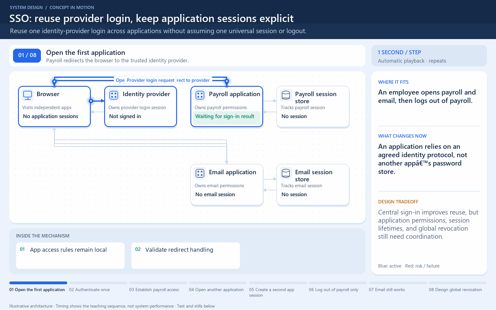

# SSO does not mean one universal app session

[← Animation index](README.md)

This is one illustrative scenario, not a complete implementation or a simulation of all failure modes. The related lesson explains assumptions and tradeoffs.

Open the looping animation

## Read the same sequence without motion

1. The user authenticates at the identity provider.
2. Payroll establishes its own application session using the sign-in result.
3. Email can reuse the provider session for sign-in, then create its own session.
4. Logging out of payroll may end only the payroll session.
5. Global logout needs an explicit plan for provider and application sessions.

[View all states as still images](../assets/animations/single-sign-on-steps.png)

## Related lessons

- [Single Sign-On (SSO)](../curriculum/10-security-and-location/03-single-sign-on-sso.md)
