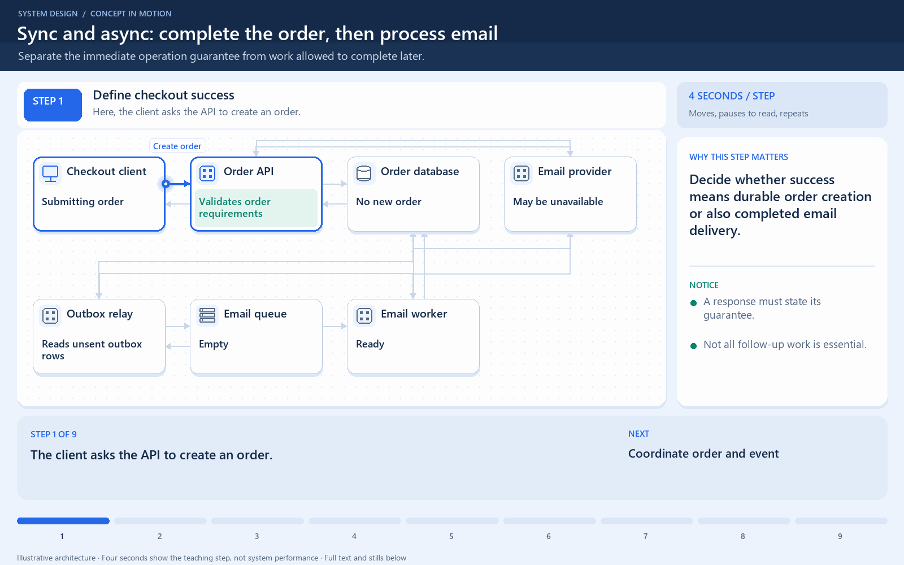

# Sync and async: complete the order, then process email

[← Animation index](README.md)

**Problem:** Separate the immediate operation guarantee from work allowed to complete later.

**Scenario:** Checkout creates an order while its confirmation email may fail and retry.

The full system map stays visible as the highlighted path and component states change. Every stage lasts one second and the sequence repeats automatically. Values are illustrative; playback speed is not system timing.

## Read the same sequence without motion

1. **Define checkout success.** The client asks the API to create an order. Decide whether success means durable order creation or also completed email delivery.
   A response must state its guarantee.; Not all follow-up work is essential..
2. **Coordinate order and event.** The API records the order and a pending outbox event in one database transaction. An outbox records the intent to publish alongside the business change.
   Avoid order saved but event lost.; This assumes a suitable transaction..
3. **Return before email finishes.** The API confirms the order while reporting email as pending. Asynchronous completion does not mean pretending unfinished work already succeeded.
   The immediate order guarantee is met.; Email is a separate observable state..
4. **Relay committed work.** A relay reads the committed outbox and submits an email event to the queue. The relay decouples committed order state from queue availability.
   Queue outage can delay publication.; Retry the same logical event safely..
5. **Record publication progress.** The relay records progress after the queue accepts the event. A crash between publish and progress recording can produce duplicate delivery.
   The outbox does not erase retries.; Consumers still need safe processing..
6. **Email fails; order remains.** The worker attempts the send, but the provider is unavailable. A follow-up failure can leave the order valid while email is still pending.
   Use bounded retries and backoff.; Track age and repeated failures..
7. **Retry the intended effect.** The worker retries with a stable operation identity under the provider's contract. External side effects need explicit duplicate and uncertain-response handling.
   A timeout may hide an accepted send.; Do not promise exactly-once by label..
8. **Expose later completion.** Processing status is recorded so support or product views can explain the email outcome. Useful asynchronous designs expose completion and failure rather than abandoning the job after acceptance.
   Store progress durably where needed.; Plan retries and manual recovery..
9. **Contrast synchronous email.** If the API sends email synchronously, the checkout response must wait for that result. Synchronous versus asynchronous describes caller waiting, not whether the underlying work exists.
   A queue moves work; does not remove it.; Choose the required user guarantee..

**Design tradeoff:** Asynchronous work shortens required waiting but introduces delayed status, retries, and durable coordination responsibilities.

[View all states as still images](../assets/animations/sync-async-steps.png)

## Related lessons

- [Synchronous vs asynchronous communication](../practice/TRADEOFFS.md)
