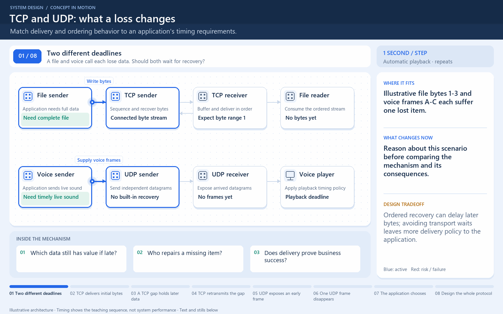

# Lost data: transport choices

[← Animation index](README.md)

This is one illustrative scenario, not a complete implementation or a simulation of all failure modes. The related lesson explains assumptions and tradeoffs.

Open the looping animation

## Read the same sequence without motion

1. TCP presents an ordered byte stream; a lost segment can delay delivery.
2. TCP detects loss and retransmits; later bytes wait for the missing data.
3. UDP sends datagrams without a built-in delivery or ordering guarantee.
4. Datagram C can arrive without transport waiting for B.
5. The UDP application chooses whether to recover, ignore, or reorder data.

[View all states as still images](../assets/animations/tcp-udp-steps.png)

## Related lessons

- [TCP and UDP](../curriculum/02-networking/03-tcp-and-udp.md)
