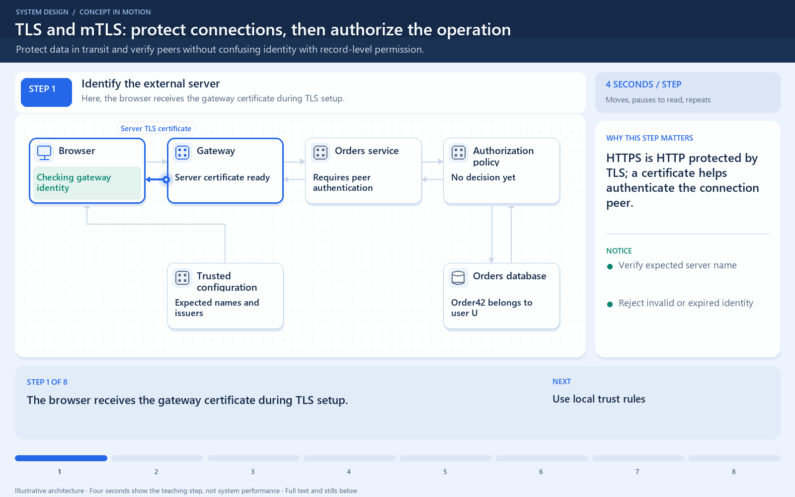

# TLS identity is separate from authorization

[← Animation index](README.md)

This is one illustrative scenario, not a complete implementation or a simulation of all failure modes. The related lesson explains assumptions and tradeoffs.

Open the looping animation

## Read the same sequence without motion

1. During TLS setup, the client validates the server certificate and identity.
2. The protected connection carries application traffic.
3. With mTLS, the server also validates a client certificate.
4. An authenticated client still needs permission for the requested operation.
5. Valid identity does not grant unlimited access to every record.

[View all states as still images](../assets/animations/tls-mtls-steps.png)

## Related lessons

- [SSL, TLS, mTLS](../curriculum/10-security-and-location/01-ssl-tls-mtls.md)
- [HTTP/HTTPS](../curriculum/02-networking/06-httphttps.md)
