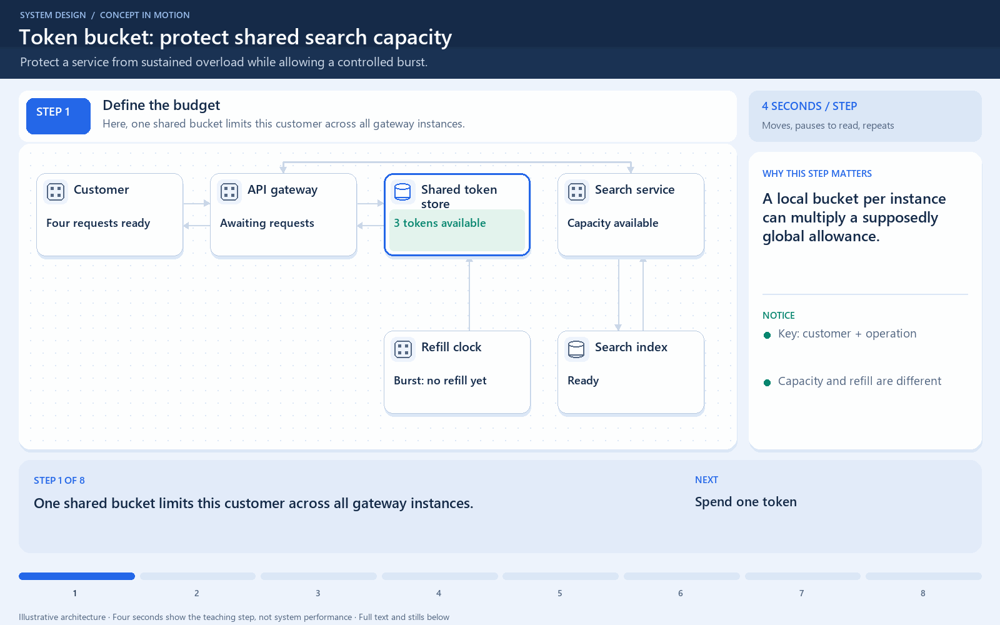

# Token bucket: bursts have a limit

[← Animation index](README.md)

This is one illustrative scenario, not a complete implementation or a simulation of all failure modes. The related lesson explains assumptions and tradeoffs.

Open the looping animation

## Read the same sequence without motion

1. This illustrative bucket holds three tokens and refills at one token/second.
2. Request 1 consumes a token and is allowed.
3. Two more requests consume the remaining tokens.
4. A new immediate request is rejected or delayed by the chosen policy.
5. After one second, one token is available again, up to the bucket capacity.

[View all states as still images](../assets/animations/token-bucket-steps.png)

## Related lessons

- [Rate Limiting](../curriculum/06-api-fundamentals/05-rate-limiting.md)
