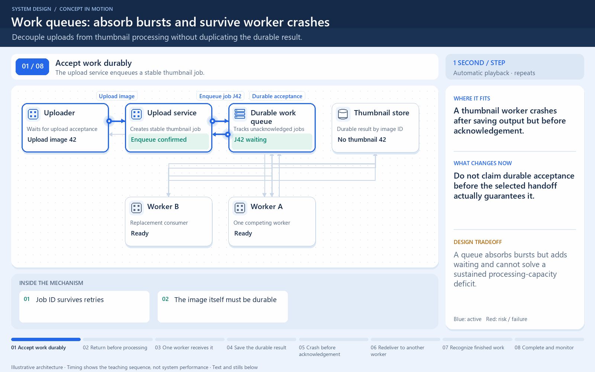

# A work queue can redeliver a job

[← Animation index](README.md)

This is one illustrative scenario, not a complete implementation or a simulation of all failure modes. The related lesson explains assumptions and tradeoffs.

Open the looping animation

## Read the same sequence without motion

1. One logical job enters a queue shared by competing workers.
2. Worker A receives J and writes the result.
3. A crashes before acknowledging. The queue may redeliver J.
4. Worker B receives J and checks the durable result or deduplication rule.
5. Safe repeated processing avoids a duplicate business effect.

[View all states as still images](../assets/animations/work-queue-steps.png)

## Related lessons

- [Message Brokers](../curriculum/07-asynchronous-communication/01-message-brokers.md)
- [Message Queues](../curriculum/07-asynchronous-communication/02-message-queues.md)
