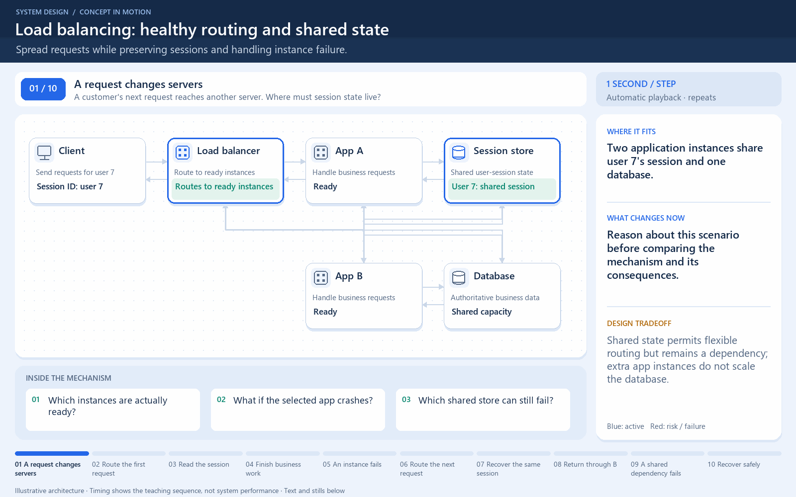

[← Category](README.md) · [Schedule](../../SCHEDULE.md)

> **Reading note:** some statements in the preserved passage need clarification. Read [Make it concrete](#make-it-concrete) with it.

<!-- BEGIN ORIGINAL TOPIC -->
# Scalability

Scalability is the measure of how well a system responds to changes by adding or removing resources to meet demands.

Let's discuss different types of scaling:

## Vertical scaling

Vertical scaling (also known as scaling up) expands a system's scalability by adding more power to an existing machine. In other words, vertical scaling refers to improving an application's capability via increasing hardware capacity.

### Advantages

- Simple to implement
- Easier to manage
- Data consistent

### Disadvantages

- Risk of high downtime
- Harder to upgrade
- Can be a single point of failure

## Horizontal scaling

Horizontal scaling (also known as scaling out) expands a system's scale by adding more machines. It improves the performance of the server by adding more instances to the existing pool of servers, allowing the load to be distributed more evenly.

### Advantages

- Increased redundancy
- Better fault tolerance
- Flexible and efficient
- Easier to upgrade

### Disadvantages

- Increased complexity
- Data inconsistency
- Increased load on downstream services
<!-- END ORIGINAL TOPIC -->

<!-- BEGIN ANIMATION -->
## Watch the sequence

Open the looping animation

[Read the numbered steps](../../animations/load-balancer.md) · [View the still sequence](../../assets/animations/load-balancer-steps.png)
<!-- END ANIMATION -->

## Make it concrete

Checkout handles 100 requests/second. Scale up with a larger server; scale out with extra servers. Measure CPU, database load, and waiting. Expand the bottleneck. Scaling alone does not determine data consistency.

[Next topic in this category](README.md) · [Credits and license](../../ATTRIBUTION.md)
