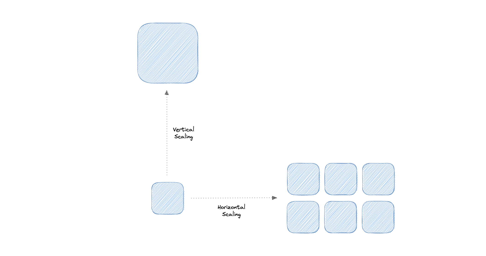

[← Category](README.md) · [Schedule](../../SCHEDULE.md)

> **Reading note:** some statements in the preserved passage need clarification. Read [Make it concrete](#make-it-concrete) with it.

<!-- BEGIN INQUIRY -->
## Try solving this first

Your ticket sale opens at noon. Traffic jumps from 100 to 20,000 requests per second; application CPU stays calm while database waits climb and checkout freezes. The team proposes twenty more app servers. Where is capacity actually missing? How could adding callers make the outage worse, and what measurement would change your decision?
<!-- END INQUIRY -->

<!-- BEGIN ORIGINAL TOPIC -->
# Scalability

Scalability is the measure of how well a system responds to changes by adding or removing resources to meet demands.

Let's discuss different types of scaling:

## Vertical scaling

Vertical scaling (also known as scaling up) expands a system's scalability by adding more power to an existing machine. In other words, vertical scaling refers to improving an application's capability via increasing hardware capacity.

### Advantages

- Simple to implement
- Easier to manage
- Data consistent

### Disadvantages

- Risk of high downtime
- Harder to upgrade
- Can be a single point of failure

## Horizontal scaling

Horizontal scaling (also known as scaling out) expands a system's scale by adding more machines. It improves the performance of the server by adding more instances to the existing pool of servers, allowing the load to be distributed more evenly.

### Advantages

- Increased redundancy
- Better fault tolerance
- Flexible and efficient
- Easier to upgrade

### Disadvantages

- Increased complexity
- Data inconsistency
- Increased load on downstream services
<!-- END ORIGINAL TOPIC -->

<!-- BEGIN ANIMATION -->
## Watch the sequence

[Read the numbered steps](../../animations/load-balancer.md) · [View the still sequence](../../assets/animations/load-balancer-steps.png)
<!-- END ANIMATION -->

## Make it concrete

Scale up adds machine resources; scale out adds machines. Measure bottlenecks before expanding capacity. Scaling alone does not determine consistency.

### Follow the waiting work

Suppose a checkout spends most of its time waiting for the database. Adding four application servers creates more callers for the same database; it can increase the queue instead of fixing it. First measure where time and capacity go. An expensive query may need a suitable index, while CPU-heavy image conversion may benefit from extra workers.

Scaling up can be a simpler first step but has hardware and failure-domain limits. Scaling out requires routing and a plan for shared state. A user whose session lives only in server A may appear logged out when the next request reaches B.

Increase load in a representative test and watch throughput, tail latency, errors, and the saturated resource together. Stop when more workers add waiting without useful completions. **Question:** if one customer causes half of all database traffic, would distributing other customers evenly solve that hotspot?

[Next topic in this category](README.md) · [Credits and license](../../ATTRIBUTION.md)
