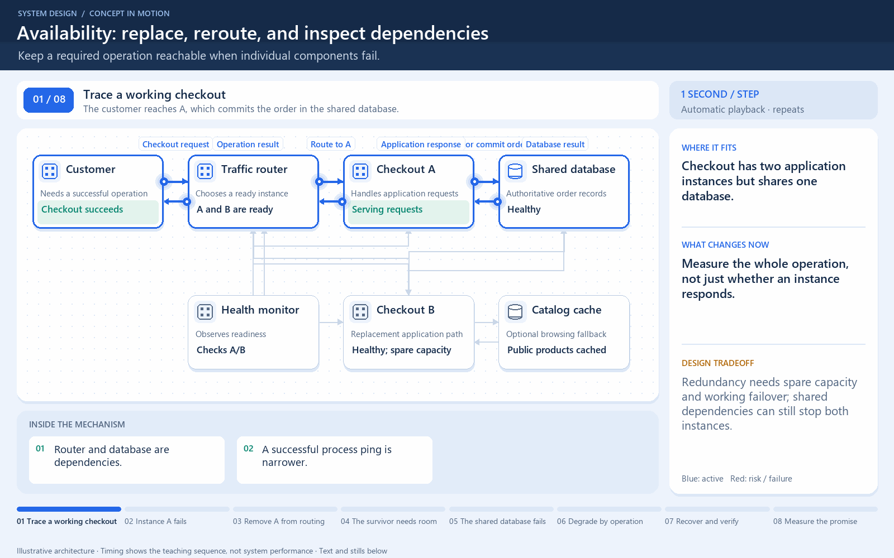

[← Category](README.md) · [Schedule](../../SCHEDULE.md)

> **Reading note:** some statements in the preserved passage need clarification. Read [Make it concrete](#make-it-concrete) with it.

<!-- BEGIN INQUIRY -->
## Try solving this first

Black Friday traffic is split across two checkout servers. At the busiest minute, server A dies with purchases in flight. Server B is healthy—but both share the same database and power zone. Which customers can still complete safely? What must fail over, what state could be uncertain, and when is a fast error more honest than a success page?
<!-- END INQUIRY -->

<!-- BEGIN ORIGINAL TOPIC -->
# Availability

Availability is the time a system remains operational to perform its required function in a specific period. It is a simple measure of the percentage of time that a system, service, or machine remains operational under normal conditions.

## The Nine's of availability

Availability is often quantified by uptime (or downtime) as a percentage of time the service is available. It is generally measured in the number of 9s.

$$
Availability = \frac{Uptime}{(Uptime + Downtime)}
$$

If availability is 99.00% available, it is said to have "2 nines" of availability, and if it is 99.9%, it is called "3 nines", and so on.

| Availability (Percent)   | Downtime (Year)    | Downtime (Month)  | Downtime (Week)    |
| ------------------------ | ------------------ | ----------------- | ------------------ |
| 90% (one nine)           | 36.53 days         | 72 hours          | 16.8 hours         |
| 99% (two nines)          | 3.65 days          | 7.20 hours        | 1.68 hours         |
| 99.9% (three nines)      | 8.77 hours         | 43.8 minutes      | 10.1 minutes       |
| 99.99% (four nines)      | 52.6 minutes       | 4.32 minutes      | 1.01 minutes       |
| 99.999% (five nines)     | 5.25 minutes       | 25.9 seconds      | 6.05 seconds       |
| 99.9999% (six nines)     | 31.56 seconds      | 2.59 seconds      | 604.8 milliseconds |
| 99.99999% (seven nines)  | 3.15 seconds       | 263 milliseconds  | 60.5 milliseconds  |
| 99.999999% (eight nines) | 315.6 milliseconds | 26.3 milliseconds | 6 milliseconds     |
| 99.9999999% (nine nines) | 31.6 milliseconds  | 2.6 milliseconds  | 0.6 milliseconds   |

## Availability in Sequence vs Parallel

If a service consists of multiple components prone to failure, the service's overall availability depends on whether the components are in sequence or in parallel.

### Sequence

Overall availability decreases when two components are in sequence.

$$
Availability \space (Total) = Availability \space (Foo) * Availability \space (Bar)
$$

For example, if both `Foo` and `Bar` each had 99.9% availability, their total availability in sequence would be 99.8%.

### Parallel

Overall availability increases when two components are in parallel.

$$
Availability \space (Total) = 1 - (1 - Availability \space (Foo)) * (1 - Availability \space (Bar))
$$

For example, if both `Foo` and `Bar` each had 99.9% availability, their total availability in parallel would be 99.9999%.

## Availability vs Reliability

If a system is reliable, it is available. However, if it is available, it is not necessarily reliable. In other words, high reliability contributes to high availability, but it is possible to achieve high availability even with an unreliable system.

## High availability vs Fault Tolerance

Both high availability and fault tolerance apply to methods for providing high uptime levels. However, they accomplish the objective differently.

A fault-tolerant system has no service interruption but a significantly higher cost, while a highly available system has minimal service interruption. Fault-tolerance requires full hardware redundancy as if the main system fails, with no loss in uptime, another system should take over.
<!-- END ORIGINAL TOPIC -->

<!-- BEGIN ANIMATION -->
## Watch the sequence

[Read the numbered steps](../../animations/availability-failover.md) · [View the still sequence](../../assets/animations/availability-failover-steps.png)
<!-- END ANIMATION -->

## Make it concrete

Two checkout servers help only if traffic switches to a usable survivor. Shared power, database, or deployment failures can defeat both. The parallel availability formula assumes independent failures and effective failover.

Trace the complete request, define successful service, and identify shared dependencies. Add readiness checks, replacement capacity, and tested failover where they remove a failure point. Keep spare capacity for surviving instances. A payment outage may allow browsing while checkout fails truthfully.

Measure successful requests and latency, not merely whether a process runs. Test switchover and in-flight outcomes; a fast error or stale answer may violate the operation's requirements.

### Decide what remains useful

For an online shop, “the website is up” is too vague. Product browsing, payment submission, and viewing an old order can have different success criteria. If payment is unavailable, keep safe functions available and show checkout's actual status; returning a success page without a confirmed operation is not useful availability.

Begin with the smallest redundancy that removes the observed failure. Two app instances do little for a database with no recovery path. Moving copies into different failure domains helps against some shared failures but adds coordination and operating cost. Run a controlled failure exercise and check both new requests and operations already in flight. The exercise should verify the user-visible promise, not just a green health dashboard.

[Next topic in this category](README.md) · [Credits and license](../../ATTRIBUTION.md)
